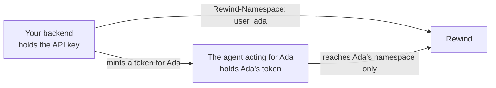

Your harness serves its own users: the **end users** of your product. In Rewind, each one has a **namespace**. Their
runs, the workflows those runs created or the namespace forked, their secrets and their use live there, and nothing of
one end user is visible to another.

## Naming the end user

A namespace's name is your own id for the end user: 1 to 128 ASCII letters, digits, `-`, `_`, `.`, `:` and `@`.
Prefer an opaque id (`user_2fQ81`) to an email: names appear in webhooks, the dashboard and logs. A namespace is
created at its first use.

To recognize who is who, give a namespace a **display name** (`Acme Corp`): `PATCH /v1/namespaces/{name}` with
`{ "displayName": "Acme Corp" }`, or `rewind namespaces rename user_2fQ81 "Acme Corp"`. The dashboard, the CLI and
the agent tools show it beside the name, and a search by prefix finds it, case aside. The name stays the key
everywhere: in paths, queries (`namespace:user_2fQ81`), the `Rewind-Namespace` header, tokens and webhooks. A display
name holds up to 128 characters and need not be unique; `null` or `""` removes it.

## Two ways to reach a namespace

- **Your backend** holds an API key, which reaches every namespace. It names the end user of each request: in the SDK,
  `rewind.namespace(user.id)`, which sends the header `Rewind-Namespace`. A key must name a namespace to start a run;
  on a read, naming one narrows the answer to it.
- **The agent acting for one end user** holds a **token** of their namespace. With it the agent, and every workflow its
  model writes, reaches that namespace and the organization's workflows only: another end user's run or workflow
  answers 404. Your backend mints opaque tokens (`rewind_nt_…`, 1 hour by default, 30 days at most), or signs JWTs
  itself with a key it registered.

A token can also carry **labels** (a conversation, an agent): it then reaches only the runs carrying them.

## Whose workflows

A workflow belongs to the namespace whose run created it. Your organization's [workflows](/concepts/workflows) are
generic: every namespace's runs execute them as they are, and a namespace forks one to change it for that end user. An
end user's token creates workflows only through the runs it starts; it never names, versions, promotes or forks one.

## Quotas

Quotas protect your platform, and your bill, from an end user who abuses your product.

| Quota | Counts |
| --- | --- |
| `activeRuns` | Runs not yet ended: queued, running or waiting. A start above it is refused |
| `runsPerMonth` | Runs started in the calendar month (UTC) |
| `cpuPerMonth` | CPU time of the end user's runs in the month, replays excluded. **Never refused**: crossing 80 % and 100 % sends an alert |
| `workflows` | Distinct workflows with a run kept in the namespace, its own and the organization's |
| `maxTtl` | The longest TTL a run may ask for |
| `maxCodeLines` | The longest code |

You set **default limits** for every end user, and **exceptions** for one: more for a paying end user,
`activeRuns: 0` to block someone. Everything stays under your organization's **ceiling**. A refused start answers
`quota-exceeded` with which quota, its limit, the use and when it frees, in words the model can relay. Crossing 80 %
and 100 % of a limit sends the webhook `quota.alert`.

## What stays yours

Action sets, your organization's workflows and webhook subscriptions belong to your organization, not to a namespace:
register your actions once, and receive every end user's webhooks, each naming its namespace. One worker with your key
serves every end user: each call says which one it acts for.

An end user's own [secrets](/sdk/secrets) (their GitHub token) belong to their namespace. A run of Alice's that uses
`ns/github` reads Alice's, never Bob's nor the organization's: nothing falls back on another secret. Your
organization's secrets (`org/…`) are shared by every end user's runs that use them.

The calls Rewind [signs](/sdk/signed-calls) for your own APIs name the end user in `sub`, from the run, never from the
code: your API learns whom it acts for from the signature.

See [End users in the SDK](/sdk/end-users) and the [Namespaces view](/dashboard/namespaces) of the dashboard.
