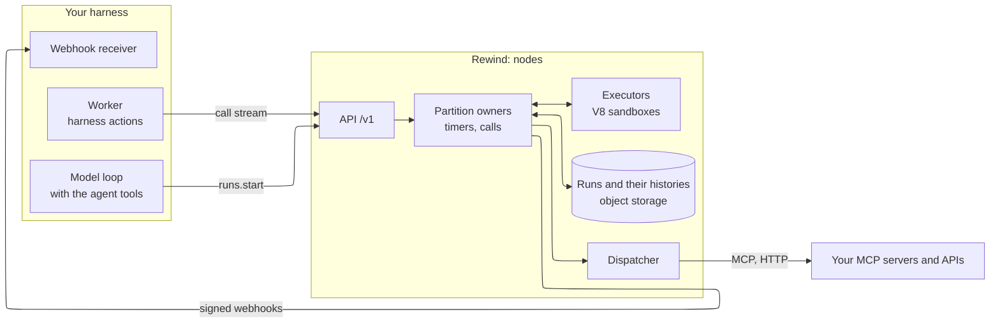
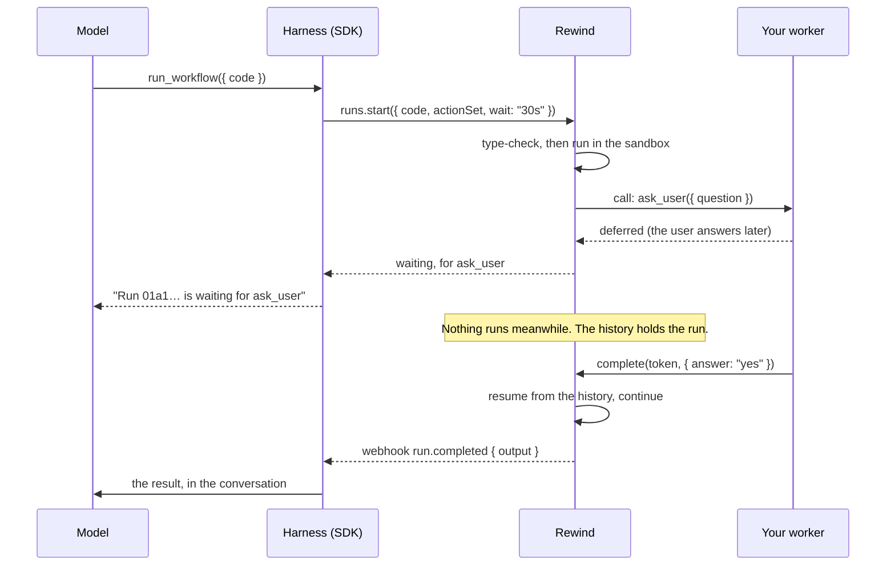

## The pieces

Your **harness** is the product that runs the agent: its model loop, its prompts, its users. It talks to **Rewind**
through the HTTP API `/v1`, usually through the TypeScript SDK.

Rewind runs as a set of identical **nodes**: each serves the API and executes runs.

| Piece | Role |
| --- | --- |
| API | Registers action sets and workflows, starts runs, takes signals and approvals, serves reads and the dashboard. Every node serves it, and sends each request about a run to the owner of the run's partition. |
| Partition owner | The runs of an end user live in one partition, and one node owns each partition at a time. The owner writes everything its runs record, in batches, and decides what happens next: which run to activate, which call to send, which timer to fire. |
| Executors | Execute workflows' code in V8 isolates, one activation at a time; the owner commits what the activation recorded. |
| Dispatcher | Sends the calls Rewind makes itself: MCP actions, API actions and the built-in `http` action. The secrets a run uses, or the signature of your organization's key, are added here, never in the sandbox. The calls of harness actions are handed to your worker's call stream. |
| Timers | Durable: `sleep`, `setTimeout`, signal timeouts, call timeouts, run deadlines, each kept with its run and fired by its owner. |
| Runs and their histories | Object storage (S3 or any S3-compatible service) holds every run: its history in its partition while it lives, sealed in the archive once it ended, and its large payloads. It is the only source of truth. Postgres holds what you configure: organizations, keys, action sets, workflows, secrets. |
| Worker | Part of your harness, from the SDK. Holds a call stream open, and executes the harness actions that live in your code. |

## The life of a run

<Steps>
  <Step title="Register an action set">
    Your MCP servers, your APIs, your own harness actions, the `http` action, the workflows the code may start. Rewind
    connects to the servers, **pins** the schemas of their tools and generates TypeScript declarations:
    `rewind-actions.d.ts` for the type-checker, and a compact rendering for the model's prompt.
  </Step>
  <Step title="Give the model its tools">
    The declarations go in the system prompt. The [agent tools](/sdk/agent-tools) go in the model's tool list:
    `run_workflow`, `check_workflow`, `test_workflow`, `get_run`, `signal_run`, `retry_run` and more.
  </Step>
  <Step title="The model calls run_workflow">
    The SDK starts a run in the namespace of the end user the agent acts for, with the code, its input, a `wait`
    (30 seconds by default), the tool call's id as idempotency key, and your labels. The code is type-checked first;
    refused code comes back to the model with its diagnostics. Code the namespace has not run before becomes one of
    its [workflows](/concepts/workflows).
  </Step>
  <Step title="The run executes">
    An executor runs the code in a sandbox. Each call to an action is recorded, then made: Rewind sends MCP, API and
    `http` calls itself, and hands the calls of harness actions to your worker's stream. If the run ends within
    `wait`, its output goes back to the model. Otherwise the model gets the run's id and what it waits for: "waiting
    for signal `approval`".
  </Step>
  <Step title="It resumes, possibly days later">
    A signal arrives, a timer fires, a human approves. The run continues from its history. When it ends, your harness
    gets a signed webhook (`run.completed`, `run.failed`), and can resume the conversation with the result.
  </Step>
</Steps>

## Why a run can wait for days

A run in Rewind holds no memory while it waits. Each time something from the outside arrives (an action's result, a
timer, a signal), its owner **activates** the run: an executor hands it to the code and lets the code run until it
waits again, and the owner commits what happened to the history in one atomic batch. That trigger and everything the
code did in response is one **step** of the history.

If the node still has the run's isolate in memory, it hands over what arrived directly. If not (another node took the
partition over, a restart, a deploy, ten days later), it starts a fresh isolate and **replays** the code against the
history: every `await` that already has a recorded result returns it at once, without calling anything, until the
code reaches what is new. Determinism guarantees that the replay takes the same path.
[The history](/concepts/history) explains how.

## Where things run

| Code | Runs in |
| --- | --- |
| The workflow the model writes | Rewind's sandbox: V8, no file system, no network except through actions |
| Your MCP servers and APIs | Wherever you host them. Rewind reaches them over HTTPS. |
| Your harness actions | Your infrastructure, in the SDK's worker |
| Your model loop | Your harness. Rewind never calls a model itself: a harness action can. |
