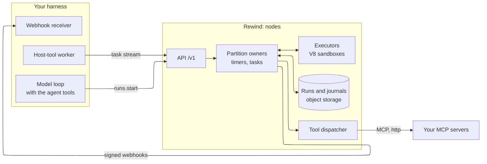
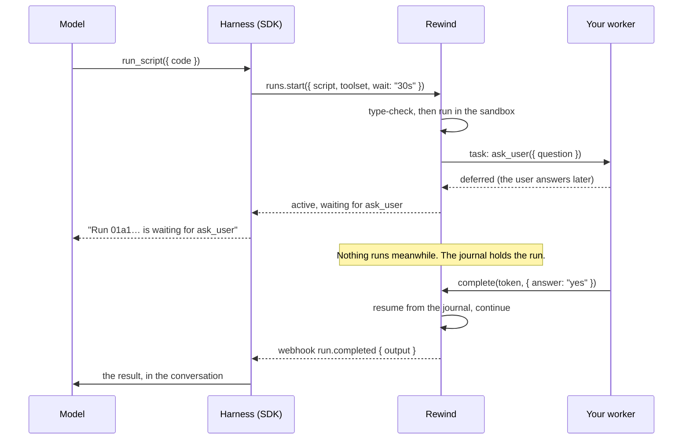

## The pieces

Your **harness** is the product that runs the agent: its model loop, its prompts, its users. It talks to **Rewind**
through the HTTP API `/v1`, usually through the TypeScript SDK.

Rewind runs as a set of identical **nodes**: each serves the API and executes runs.

| Piece | Role |
| --- | --- |
| API | Registers toolsets and workflows, starts runs, takes signals and approvals, serves reads and the dashboard. Every node serves it, and sends each request about a run to the owner of the run's partition. |
| Partition owner | The runs of an end user live in one partition, and one node owns each partition at a time. The owner writes everything its runs record, in batches, and decides what happens next: which run to activate, which call to send, which timer to fire. |
| Executors | Execute scripts in V8 isolates, one activation at a time; the owner commits what the activation recorded. |
| Tool dispatcher | Sends the calls Rewind makes itself: MCP tools, API tools and the built-in `http` tool. The secrets a run attached, or the signature of your organization's key, are added here, never in the sandbox. Calls to host tools are handed to your worker's task stream. |
| Timers | Durable: `sleep`, `setTimeout`, signal timeouts, call timeouts, run deadlines, each kept with its run and fired by its owner. |
| Runs and journals | Object storage (S3 or any S3-compatible service) holds every run: its history in its partition while it lives, its journal in the archive once it ended, and its large payloads. It is the only source of truth. Postgres holds what you configure: organizations, keys, toolsets, workflows, secrets. |
| Host-tool worker | Part of your harness, from the SDK. Holds a stream open, and executes the tools that live in your code. |

## The life of a run

<Steps>
  <Step title="Register a toolset">
    Your MCP servers, your own host tools, the `http` tool, the workflows scripts may start. Rewind connects to the
    servers, **pins** the schemas of their tools and generates TypeScript declarations: `rewind-tools.d.ts` for the
    type-checker, and a compact rendering for the model's prompt.
  </Step>
  <Step title="Give the model its tools">
    The declarations go in the system prompt. The [agent tools](/sdk/agent-tools) go in the model's tool list:
    `run_script`, `check_script`, `test_script`, `get_run`, `signal_run`, `retry_run` and more.
  </Step>
  <Step title="The model calls run_script">
    The SDK starts a run in the namespace of the end user the agent acts for, with the script, its input, a `wait`
    (30 seconds by default), the tool call's id as idempotency key, and your labels. The script is type-checked first;
    a refused script comes back to the model with its diagnostics.
  </Step>
  <Step title="The run executes">
    An executor runs the script in a sandbox. Each tool call becomes a task: Rewind sends MCP and `http` calls itself,
    and hands the calls to host tools to your worker's stream. If the run ends within `wait`, its output goes back to
    the model.
    Otherwise the model gets the run's id and what it waits for: "waiting for signal `approval`".
  </Step>
  <Step title="It resumes, possibly days later">
    A signal arrives, a timer fires, a human approves. The run continues from its journal. When it ends, your harness
    gets a signed webhook (`run.completed`, `run.failed`), and can resume the conversation with the result.
  </Step>
</Steps>

## Why a run can wait for days

A run in Rewind holds no memory while it waits. Each time something from the outside arrives (a tool's result, a timer,
a signal), its owner **activates** the run: an executor delivers the event to the script and lets the script run until
it waits again, and the owner commits what happened to the journal in one atomic batch.

If the node still has the run's isolate in memory, it delivers the event directly. If not (another node took the
partition over, a restart, a deploy, ten days later), it starts a fresh isolate and **replays** the script against the
journal: every `await`
that already has a recorded result returns it at once, without calling anything, until the script reaches the new
event. Determinism guarantees that the replay takes the same path. [The journal](/concepts/journal) explains how.

## Where things run

| Code | Runs in |
| --- | --- |
| The script the model writes | Rewind's sandbox: V8, no file system, no network except through tools |
| Your MCP servers | Wherever you host them. Rewind reaches them over streamable HTTP. |
| Your host tools | Your infrastructure, in the SDK's worker |
| Your model loop | Your harness. Rewind never calls a model itself: a host tool can. |
