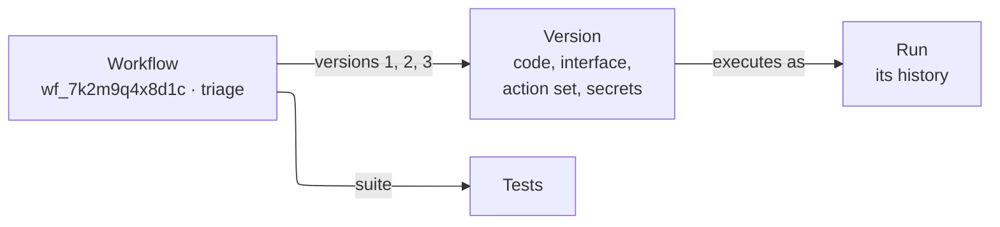
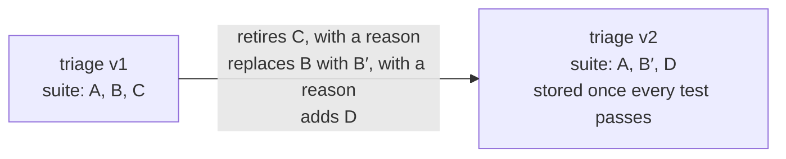

A **workflow** is the template of its runs: the model writes it, and running it gives a run. Every run is a run of a
workflow, and the runs its code starts are its child runs. A workflow's TypeScript text is its **code**.



## Its id

The API gives a workflow its id, `wf_` and 12 characters (`wf_7k2m9q4x8d1c`), the first time it sees its code in a
namespace. A run given code that neither its namespace nor the organization has creates a workflow in its namespace,
with that code as its version 1. The same code sent again without naming a workflow is the same workflow: its id does
not change while its code does not.

Checking or testing code reads workflows, and creates or changes none.

## Its versions

A workflow has versions 1, 2, 3…, each a code, an interface, a pinned [action set](/concepts/actions) and the
[secrets](/sdk/secrets) its runs use. A version is immutable: its `version` is its number, its `digest` the hash of its
document, and `triage@v12` and `triage@<digest>` both name it. A run always executes one version, and a new version
never changes a run already going.

New code becomes a workflow's next version only when the call names that workflow, by its id or its name; code sent
without one is another workflow.

## Its name and description

A name is optional. It is an identifier (`rewind:workflows` exports it) that does not start with `wf_`, unique in the
workflow's scope. With a name, callers start the workflow by name and read it in its runs' handles.

A workflow shows as its name, else the first line of the comment at the top of its latest version's code, else its
short id (`wf-7k2m9q`). Its description is the one given, else the rest of that comment. Both are display only: never
its identity, its version or its runs' handles.

```ts
/**
 * Triage the stale issues of a repository
 *
 * Posts them to Slack, waits for an approval, then closes them.
 */
import { github, slack } from "rewind:actions";
```

## Its interface

JSON Schemas for its input, its output and each signal it accepts. A version without one accepts any input, output and
signal name, as the version 1 a run creates does. Giving one makes the next version, checked against its code: the
default export must accept the input and return the output, and `signal(name)` only takes a declared name and returns
that signal's type. Code that starts the workflow is checked against the same schemas before it runs.

## Its scope

A workflow belongs to the [namespace](/concepts/end-users) whose run created it: end users are isolated by their
namespace, their code too. A member or an API key with `workflows:write` **promotes** it to the organization, or
creates one there directly.

The organization's workflows are generic: any namespace's run executes them as they are. A name resolves in the
caller's namespace first, then among the organization's workflows: a run or a harness in a namespace that names `gym`
gets the namespace's `gym`, else the organization's.

## Its forks

A namespace changes an organization workflow by **forking** it. A fork is a namespace workflow whose `source` is the
organization's workflow and one of its versions:

- it keeps its source's name, so the namespace's runs that name the workflow get the fork from then on;
- it starts with a copy of its source's suite, without the tests recorded from another namespace's runs, and the suite
  then evolves on its own;
- it **pulls** its source's latest version (its code, interface and action set), which becomes its next version once
  the fork's own suite passes, else nothing changes (`tests-failed`).

Members and API keys with `workflows:write` fork and pull, so a harness forks for its end users; an end user's token
does not. A namespace's workflow is not forkable.

A fork of a workflow and a [fork of a run](/concepts/history#forks-fix-a-run-without-repeating-its-effects) are the same
act on two things: a copy that diverges from its source.

## A suite that follows the versions

A **test** gives a workflow's code a world (its input, the answers to its calls, the signals it receives) and says what
the outside must see at the end: how the run ends and the calls it makes. It never names the code, so a test written
for one version runs unchanged against the next. It runs as a test run, in virtual time, with a fixed start and seed,
so it cannot be flaky. See [Testing](/sdk/testing#tests).

Each workflow carries a **suite**: the tests every new version must pass. Making a version goes through a **gate**:
every test of the suite runs against the version's code and action set, and the version is stored only if every test
passes; there is no way around it. Each version records the suite it passed.



To change a behavior a test pins, the new version **retires** the test, because it is deprecated, or **replaces** it,
because its state or its result is out of date, and says why in both cases. The reasons stay in the workflow's
lineage: whoever reads a version, a person in the dashboard or a model with `get_workflow`, learns what changed on
purpose.

Past runs become tests too. **Recording** takes the completed and failed runs of a workflow, groups them by the path
they took (the actions they called, the signals they waited for, how they ended), and keeps the newest run of each path
as a test: its real input, the real answers to its calls, and what it returned. A recorded test joins a suite only
through the gate. See [Record tests from runs](/sdk/workflows#record-tests-from-runs).

A fix of a failed run of a workflow, with `retry_run` or `runs.fork`, runs the suite of the run's version against the
corrected code first: a fix that breaks another behavior never reaches production calls.

Tests are stored as content-addressed documents, and a version holds their digests: "this version passed these tests"
never changes. A recorded test holds its run's data: only those who may read the runs of its namespace read it, and it
is erased with that namespace.

## What each call does to a workflow

| Call | Creates or changes |
| --- | --- |
| A run with code, no workflow named | A workflow in its namespace and its version 1, when the code is new there; the run |
| A run of a workflow (its id or name, a version or the latest) | The run only |
| A check of code | Nothing: diagnostics |
| A test of code or of a workflow's version | Nothing: a test report |
| New code, an interface, an action set or secrets for a workflow it names | Its next version, once its suite passes; the same id |
| A test added to its suite | The test, once it passes against the latest version; the same id, no new version |
| A name, a description | Those fields; the same id, no new version |
| Promoting it | It moves from its namespace to the organization |
| Forking an organization workflow | A namespace workflow with its name, its version as version 1 and a copy of its suite |
| Pulling into a fork | The fork's next version, once the fork's suite passes |

## Started by code

An action set lists the organization's workflows its code may start, and pins their latest versions (or the version
it names: `triage@v12`) when it is registered. The code imports them from `rewind:workflows`, typed by their
interfaces:

```ts A workflow that starts runs of triage
import { triage } from "rewind:workflows";

export default async function main(input: { repos: string[] }) {
  const runs = await Promise.all(input.repos.map((repo) => triage.start({ repo })));
  await Promise.all(runs.map((run) => run.signal("approval", { close: true })));
  const results = await Promise.all(runs.map((run) => run.result()));
  return { closed: results.reduce((sum, result) => sum + result.closed, 0) };
}
```

| Call | Does |
| --- | --- |
| `triage.start(input, opts?)` | Starts a child run of the pinned version and returns its handle once the run exists. `opts`: `detached`, `labels` (added to the parent's), `ttl` |
| `run.signal(name, payload)` | Sends one of the workflow's signals. Resolves once the signal is in the run's mailbox |
| `run.result()`, `run.result({ timeout })` | The run's output. Rejects with `RunError` if it failed, was cancelled or aborted |
| `triage.get(runId)` | A handle on an existing run of the workflow, to signal it |

A child run started this way runs the pinned version, whatever its namespace has forked since.

## Attached and detached child runs

A child run is **attached** to its parent, the run that started it: the parent does not end before its attached
children, and a parent that fails, is cancelled or aborted cancels the children still active. A forgotten `result()` is
harmless.

A child started with `detached: true` lives on its own: start a long workflow and move on.

## Started by your harness

Your harness starts runs of a workflow too, by its id or its name (its latest version) or by version, and signals them:

```ts
const run = await rewind.namespace(user.id).runs.start({ workflow: "triage", input: { repo: "acme/api" } });
await rewind.runs.signal(run.id, "approval", { close: true });
```

A run of a version that declares its signals accepts only those, with a payload that matches their schema; anything
else is refused (422), whoever sends it.

In the dashboard, a run shows its workflow and version, the run that started it, and the runs it started in **Runs
started**. See [Workflows in the SDK](/sdk/workflows).
