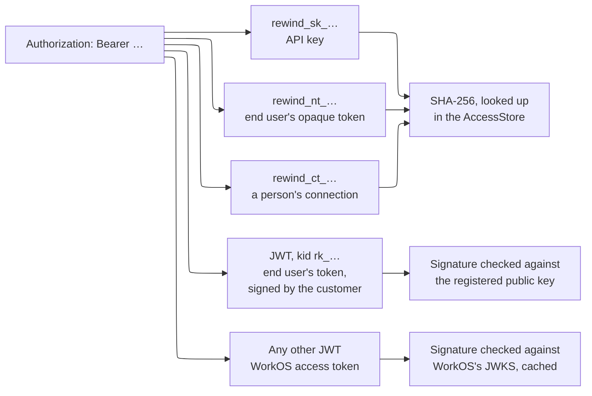
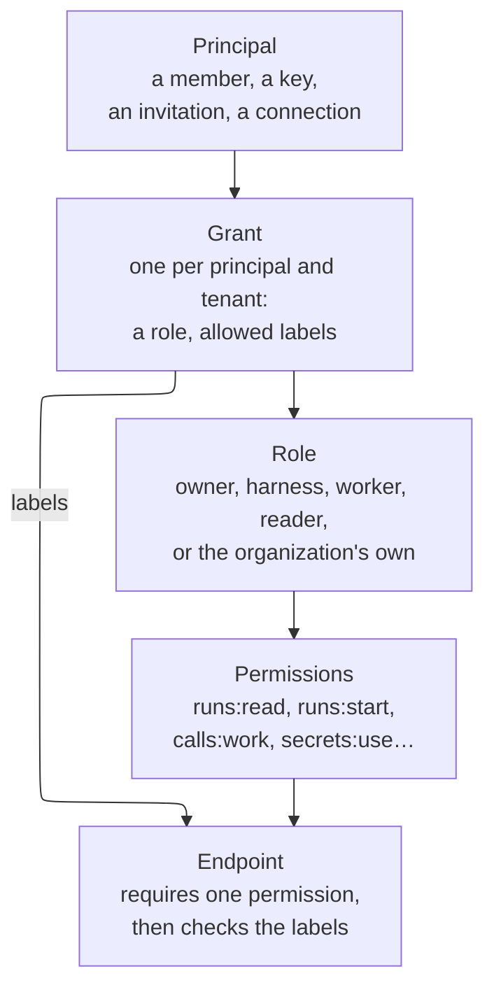
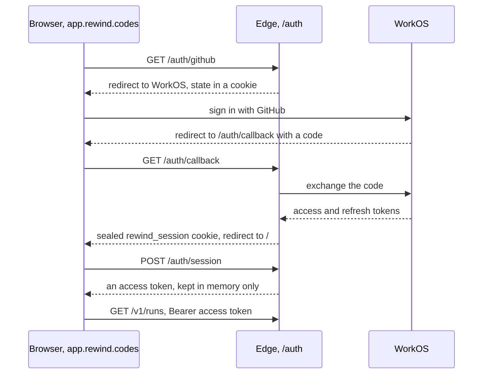
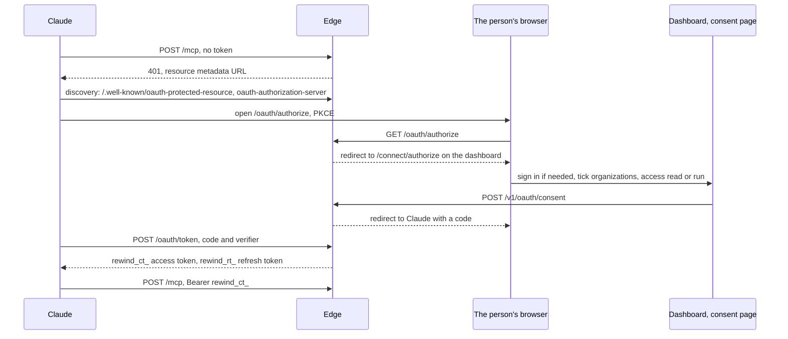

## Four questions, kept apart

| Question | Answered by |
| --- | --- |
| **Who calls?** | An API key, a member's WorkOS session, an end user's token, or a person's connection |
| **Which tenant?** | The key's tenant, the member's organization, the token's, or the `Rewind-Organization` header of a connection |
| **Which namespace?** | The token's own; for keys, members and connections, the `Rewind-Namespace` header |
| **What may it do?** | Rewind alone: the caller's grant, its role, the role's permissions; a token's own permissions |

**WorkOS holds identity and nothing else**: people, organizations, memberships, invitations, the waitlist. It never says
what someone may do. Rewind reads no role or permission from WorkOS, and copies no person or organization: a tenant is a
WorkOS organization, and its id is the organization's.

## Who calls

Every request to `/v1` carries a Bearer token, and nothing else authenticates it: no cookie. The edge tells the kinds
apart by their form.

| Caller | Credential | Used by |
| --- | --- | --- |
| A harness, the SDK, the CLI | API key, stored hashed, with a name and its creator | Your backend |
| A member in the dashboard | WorkOS access token (RS256, 5 minutes), checked locally against WorkOS's keys | People |
| An agent acting for one end user | An opaque token minted by your backend, or a JWT your backend signs with a key it registered (EdDSA, ES256, RS256) | Your agent, inside one namespace |
| An MCP client acting for a person | A connection's access token (1 hour), renewed with a refresh token | Claude |

Every request reads the credential's state again: a revoked key, token or grant applies from the next request, and
closes the streams it opened.

## Namespaces isolate end users

Your organization (a tenant, to the engine) is your company; a **namespace** is one of your end users. The runs
started for Alice, their histories, signals, calls and payloads, the workflows they created, Alice's secrets, usage and
tokens belong to Alice's namespace.

- An agent holding a token of Alice's namespace cannot see or reach anything of Bob's, whatever code its model writes:
  another namespace's run is a 404.
- A run only reaches runs of its own namespace, and its namespace fixes its [partition](/engineering/cluster#partitions).
- What stays the organization's: action sets, the workflows a member promoted to it, its secrets, its signing key,
  subscriptions, members, roles, keys. A namespace runs the organization's workflows as they are, or
  forks one to change it for its end user.
- A namespace is created at first use, and its deletion erases the end user: tokens revoked, active runs cancelled, ended
  runs and secrets erased.

## What the caller may do

- **Permissions** are Rewind's catalog, one per kind of thing the API lets a caller do. Every endpoint requires one.
- **Roles** are sets of permissions: four built in (`owner`, `harness`, `worker`, `reader`), and those an organization
  creates.
- **A grant** gives one role to one principal (`member:<id>`, a key, an invitation, a connection) in one tenant,
  optionally limited to **allowed labels**. A grant limited to `env=prod` sees only the runs carrying that label,
  receives only the calls of their harness actions, and gives its labels to what it creates.
- **No one gives more than they hold**, and an organization always keeps an owner: both checked atomically in the store.
- **Tokens** hold the permissions they were given, within their namespace only.

Grants, roles and tokens live in the control plane (`AccessStore`). A change is pushed to every node by `NOTIFY`, so a
narrowed grant applies at once, without waiting for any token to expire.

## Signing in to the dashboard

The dashboard signs in through `/auth`, the only routes that read a cookie.

- The session cookie is sealed (AES-256-GCM), `HttpOnly`, `Secure`, `SameSite=Strict`, scoped to `/auth`.
- The access token lives 5 minutes; `POST /auth/session` refreshes it when less than a minute is left.
- People sign in with GitHub or a 6-digit code by email. Sign-ups go through WorkOS's waitlist, and the operator's
  approval sends an invitation.

## Connecting Claude

Rewind is the OAuth authorization server of its own MCP endpoint, `/mcp`. A person's consent creates a **connection**:
their key, outside every organization, opening the organizations they tick.

- A connection gets a grant in each organization it opens, with the role `reader` or `harness`. It never holds more than
  its person holds there at the time of each request, and never administers anything.
- A refresh token is replaced at each use; one used twice revokes the connection.
- `/mcp` serves the agent tools without a session. Each tool calls `/v1` on the same server over loopback, with the
  caller's Bearer: one authorization path for every client.

## Quotas

Quotas protect the platform and you from one end user's abuse: active runs, runs per month, CPU per month, workflows,
the longest TTL and the longest code.

- Each partition counts its runs and CPU per namespace, **in the batch of what it counts**: counts cannot drift from
  facts.
- Owners report their counts to the [tenant actor](/engineering/cluster#tenant-actors), which admits starts one at a
  time. A start above a limit is refused at once with 429, and a message written for a model.
- CPU is metering: it never stops or pauses a run, and replays are not counted. Crossing 80 % and 100 % sends a
  `quota.alert`.
