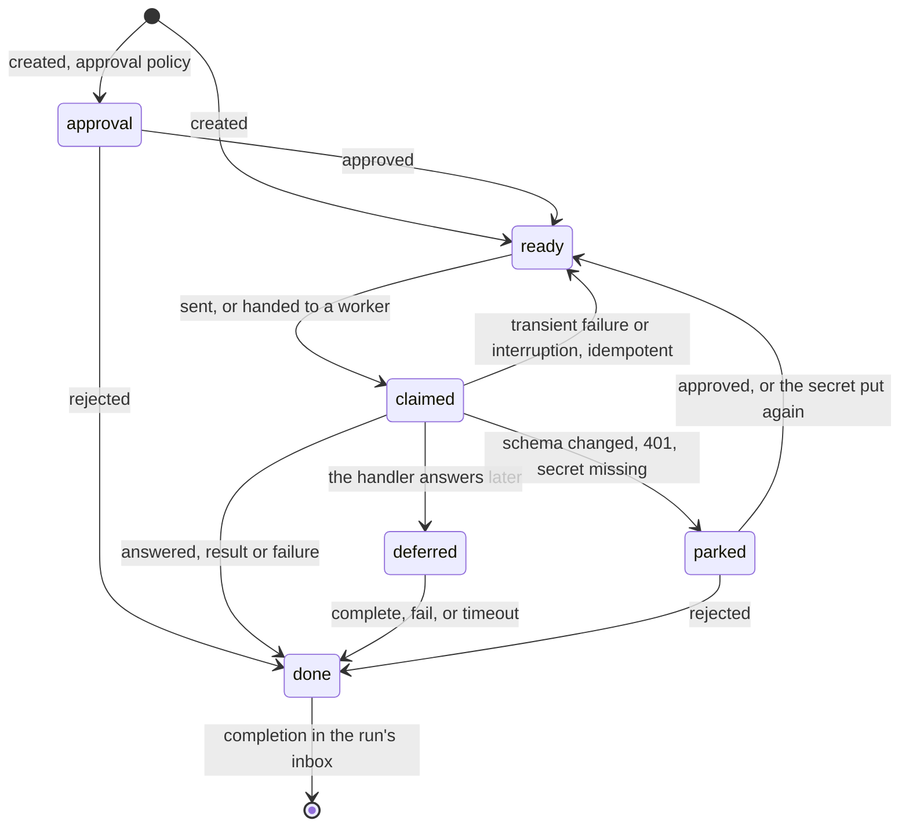
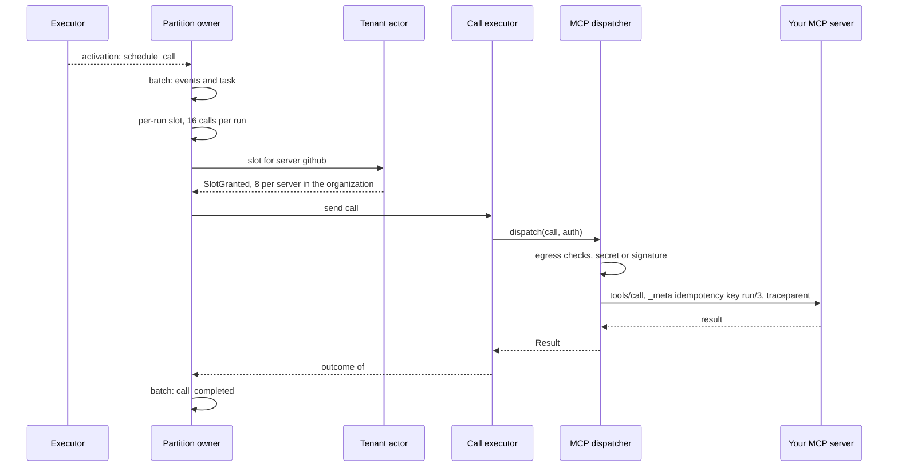
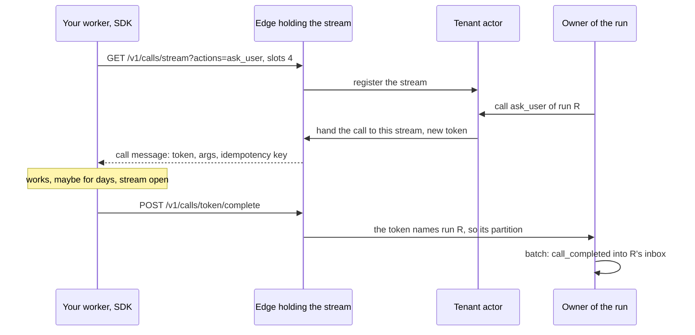
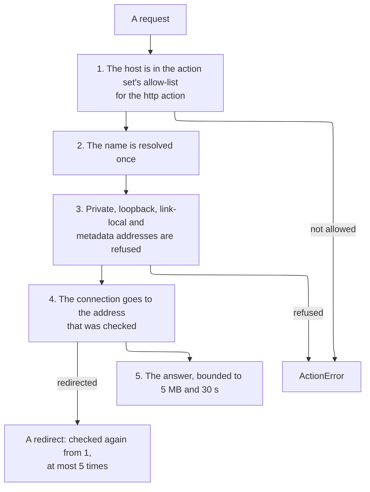

## Four kinds of actions

What a workflow calls is an **action**. Its prefix is its **group**: `github.list_issues` is the action `list_issues` of
the group `github`.

| Route | Sent by | Used for |
| --- | --- | --- |
| **MCP actions** | Rewind's dispatcher, an MCP client over Streamable HTTP (stdio on your machine) | Every tool of the action set's MCP servers |
| **API actions** | Rewind's dispatcher, an HTTP client built from an OpenAPI document | Every operation of the action set's APIs |
| **Built-ins** | The dispatcher for `http`; the engine itself for `signalUrl` and `workflows.<name>.start`, `.signal` | The network, signal URLs, runs of workflows |
| **Harness actions** | Your worker, which holds a call stream open | Functions that live in your harness: ask the end user, call a model, start a sub-agent |

Results go back to the workflow's code, never to the model. Your harness is on the path only for its harness actions.

## A call and its task

Each `schedule_call` makes a **call**. Under the hood, the dispatcher carries it as a **task**, kept with its run in the
partition: deliveries, backoff, approvals and tokens live in the task; the history only gets the final outcome.

- The task is written in the batch that commits its call, and **nothing is sent before that batch is durable**.
- Sending a call writes nothing. While a call is in flight, its task still says `ready`; only the owner's memory knows it
  left. What is written is what happened: a backoff, an interruption, the outcome. No heartbeat, no lease.
- A call decides its run's status: an MCP, API or `http` call in flight or backing off is Rewind's own work, and its run
  is `running`; a harness action's call, or a call in `approval`, `deferred` or `parked`, waits for the outside world,
  and its run is `waiting` once nothing else moves it.
- When a run ends, its tasks are deleted: a call still queued is never sent, and a result that arrives later is dropped.

## The path of an MCP call

- **Idempotency.** Every delivery of a call carries the key `{run_id}/{seq}`: in MCP `_meta`
  (`codes.rewind/idempotency-key`), in an API's `Idempotency-Key` header when its operation declares one, and to
  harness action handlers with the delivery's number (`ctx.delivery`). A call delivered again after an interruption
  carries the same key, so the action can recognize it.
- **Tracing.** Calls carry the W3C trace context, with the Call span as parent, so the server's own spans join the
  run's trace.
- **Concurrency.** Two limits: calls in flight per run (16), kept by the owner, and calls in flight per MCP server or API
  in the whole organization (8), kept by the tenant actor, which grants slots in the order they are asked for. A call
  waiting for a slot stays `ready`: the history never sees it.
- **A dispatcher never writes to a store.** It answers `Result`, `Failed`, `Transient` (deliver again with backoff),
  `Deferred`, or `Park` with a reason. The owner decides what to write.

## Policies

Each action has a policy, pinned in its action set.

| `idempotent` | On a transient error | When interrupted (its node died) |
| --- | --- | --- |
| `true` (the default) | Delivered again with backoff | Delivered again with the same key, up to 5 deliveries, then failed with `outcomeUnknown` |
| `false` (for an action that ignores the key; the default of an API's `POST` and `PATCH` without an idempotency header) | Failed | Failed with `outcomeUnknown` |

Other settings: `approval` (the call waits for the harness before it is sent), an execution timeout (5 minutes for MCP
and API actions), `reconnectTimeout` (how long a harness action's call waits for its worker's stream to come back, 60 s)
and `concurrency`.

## Harness actions

Harness actions run in your code, through the SDK's worker. Nothing reaches your infrastructure from outside: the worker
opens a call stream and is handed its calls.

- **The open stream is the liveness** of every call handed on it. If it closes and the worker does not come back within
  the `reconnectTimeout`, the owner writes delivery + 1 and the tenant actor hands the call to another worker (or the
  owner fails it under `idempotent: false`).
- A long call can be **deferred**: it then waits for `complete` or `fail` whether the stream stays open or not, bounded
  by a timeout and the run's TTL.
- A worker only receives the calls of the runs its credential sees: an end user's token, its namespace; a grant limited
  to allowed labels, the runs carrying them.
- The tenant actor keeps the streams in memory. When its home partition moves, it tells every node, and each edge
  registers its open streams again.

## Proving who calls

An action set says, per MCP server or API, how its calls authenticate. The action set holds no value: a run names the
secrets it uses when it starts.

| `auth` | The request carries |
| --- | --- |
| None | Nothing: a public server |
| `{ "type": "secret", "header": … }` | A secret the run uses (`org/<name>` or `ns/<name>`), in that header |
| `{ "type": "rewind" }` | A JWT signed with the tenant's Ed25519 key |

### Secrets

- A run reads a secret only if its start named it, per server: `secrets: { "github": "ns/github" }`. Alice's run never
  calls with Bob's token, nor falls back on the organization's.
- At each call, the dispatcher reads the secret from the `SecretStore`, decrypts it, injects it into the transport, and
  counts the read. Secrets never enter the history, the isolate, a cassette, OpenTelemetry, or an API answer.
- A secret deleted since parks the call (`secret.expired`, reason `missing`); a 401 parks it too (`refused`). Putting
  the secret again is a change of the control plane: every owner receives it and makes those calls `ready`, delivered
  with the same idempotency key.

### Signed calls

With `auth: { "type": "rewind" }`, Rewind keeps no secret of yours. It signs each request with the tenant's key, and your
server checks the signature with the public keys at `{public-url}/organizations/{organization}/jwks.json`.

| Claim | Value |
| --- | --- |
| `iss` | `{public-url}/organizations/{organization}` |
| `aud` | The API's base URL, or the MCP server's URL |
| `sub` | The run's namespace: the end user |
| `labels`, `run`, `action` | The run's labels and id, the action's name (also in `tool`, for older verifiers) |
| `idempotency_key`, `jti` | `{run_id}/{seq}`, and `{run_id}/{seq}/{delivery}` |
| `htm`, `htu`, `body` | The method, the URL, the SHA-256 of the body |
| `iat`, `exp` | Now, and 60 seconds later |

The JWT covers the method, the URL and the body, so a server that receives one cannot replay it elsewhere. The SDK's
`verifyRewindCall` does every check.

## Egress

The `http` action's requests, MCP calls, API calls and webhooks all leave from the node, never from the isolate, and go
through the same checks in `rewind-outbound`:

- A DNS answer that changes between the check and the connection cannot reach the internal network: the connection goes
  to the address that was checked.
- An MCP server or an API follows a redirect only within its origin, so a secret or a signature never follows it
  elsewhere. Up to 5 redirects.
- An operator may let internal servers through by name or network (`--allow-internal-addresses`). What they answer is
  never quoted to the organization.
- The embedded server on your machine reaches any address, and starts stdio MCP servers.

## When an action set changes during a run

A run keeps the action set it started with, but the server behind it can change during a long wait. The MCP dispatcher
checks each call against the server's current schema. A call that no longer matches is **parked**, and your harness gets
`action.schema_changed`: approve it to send it anyway, fork the run with corrected code, or reject the call.
