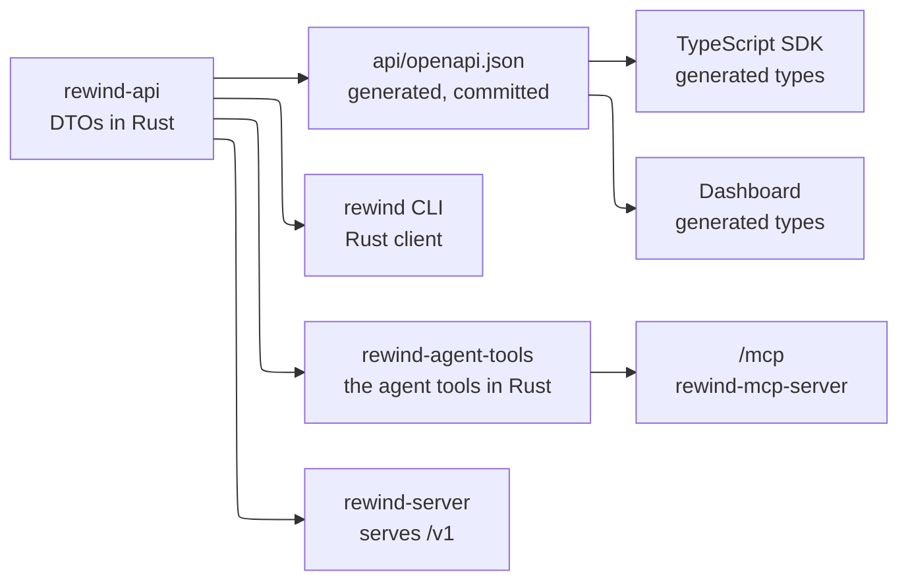
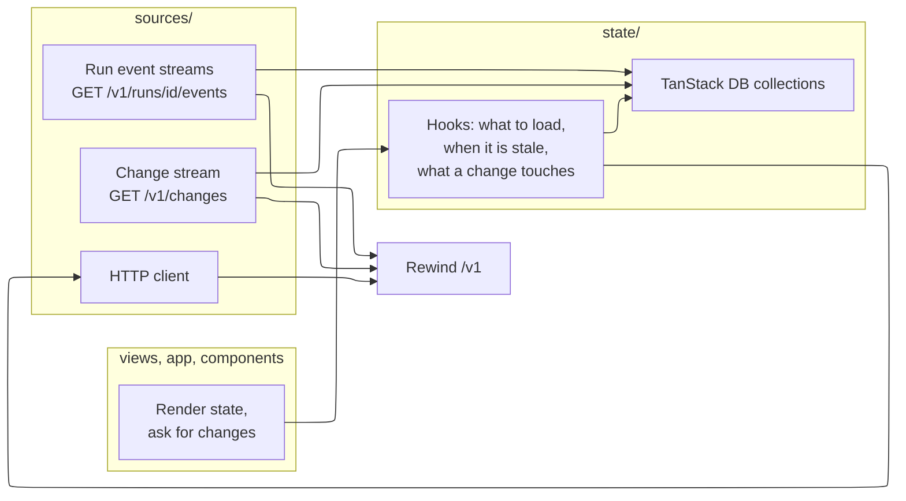
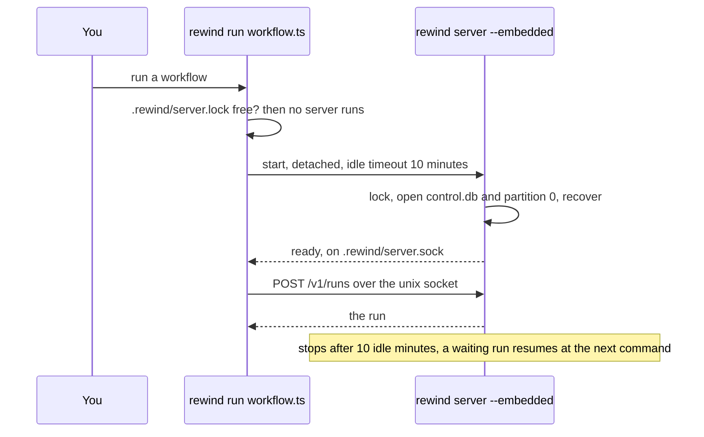

Every client reaches Rewind through the same public API, `/v1`. None has a private path into the engine.

The API's types are Rust structures in `rewind-api`. The OpenAPI document is generated from them and committed; a test
fails when it is stale. The SDK's and the dashboard's TypeScript types are generated from that document, so the server,
the SDK and the dashboard cannot disagree on a field.

## The TypeScript SDK

`@rewind.codes/sdk` is what a harness uses. It has four parts:

| Part | Does |
| --- | --- |
| **The client** | One resource per group of `/v1`: runs, workflows, action sets, namespaces, secrets, calls, subscriptions. Idempotency keys, problem errors, server-sent events read with `fetch` |
| **The worker** | Holds `GET /v1/calls/stream` open, runs the handlers of your harness actions, answers each call with `complete`, `fail` or `defer`; reopens the stream after a drop |
| **The agent tools** | `run_workflow`, `check_workflow`, `test_workflow`, `get_run`, `signal_run`, `retry_run`… as tool definitions for your model, with handlers and results rendered as bounded plain text |
| **Verifiers** | `verifyWebhook` for webhooks, `verifyRewindCall` for a server that receives signed calls |

The agent tools exist twice: in the SDK, and in Rust (`rewind-agent-tools`) for Rewind's own MCP endpoint. Golden
fixtures shared by both keep their texts identical.

## The dashboard

The dashboard is a React single-page application built with Vite. Every node embeds its build and serves it, and the
hosted one is served at `app.rewind.codes`, which rewrites `/v1` and `/auth` to the API.

- **Layers enforced by the linter.** Views import only `state/`; only `sources/` talks to the server. A new way for the
  server to push changes touches `sources/` alone.
- **Live without polling.** One change stream per tab pushes each run's summary as its owner commits it, and the
  control plane's changes. No view reads on a timer, and the lint refuses `refetchInterval`. After a drop, the stream
  reopens (1 s, doubling up to 30 s) and the views read again what they show.
- **Stable rendering.** An answer equal to what is shown renders nothing; rows are keyed by id; new rows wait behind a
  "N new" slot while the table is scrolled.
- **Scope.** The same views run over every namespace of the organization or over one, under `/ns/<name>/`. In one
  namespace, the reads send `Rewind-Namespace` and their cache keys hold it, so what was read for one end user never
  shows for another.
- **Rights.** The views follow the permissions `/v1/whoami` answers: a member sees what their grant gives.

## The CLI and the embedded server

The `rewind` binary is also the CLI. The CLI never opens storage itself: it is a client of `/v1`, of a remote server or
of an embedded server it starts for the project's `.rewind/` directory.

| In `.rewind/` | Holds |
| --- | --- |
| `server.lock`, `server.sock` | The lock of the one server of the directory, and its socket (mode 0600, no token) |
| `control.db` | Turso: the control plane |
| `master.key` | The master key of the secrets, made at first start |
| `partitions/0/` | SlateDB: the one partition |
| `runs/`, `blobs/`, `tests/` | The archive, large payloads, test documents |

The embedded server is a production node with other adapters: one partition, Turso instead of Postgres, local files
instead of object storage, a cluster of one, the node link inside the process. A `kill -9` loses nothing: the next command starts a
server that recovers the partition, and the timers that came due meanwhile fire at once.

`rewind check`, `rewind test` and the replay of a run export run in the CLI process itself, without a server.

## The MCP endpoint

`POST /mcp` serves the agent tools to Claude and any MCP client, over Streamable HTTP without session. A tool call runs
the same handler as the SDK's, and reaches `/v1` on the same server over loopback with the caller's credentials: the
MCP endpoint adds no authorization path of its own. Model-written code it runs (tests, a workflow's suite) runs on the
node that answers, inside its sandbox. `rewind mcp` serves the same tools over stdio against the embedded server, for
debugging them.
