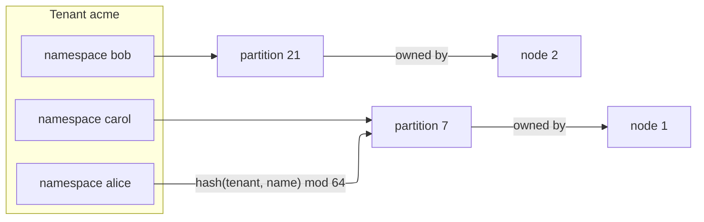
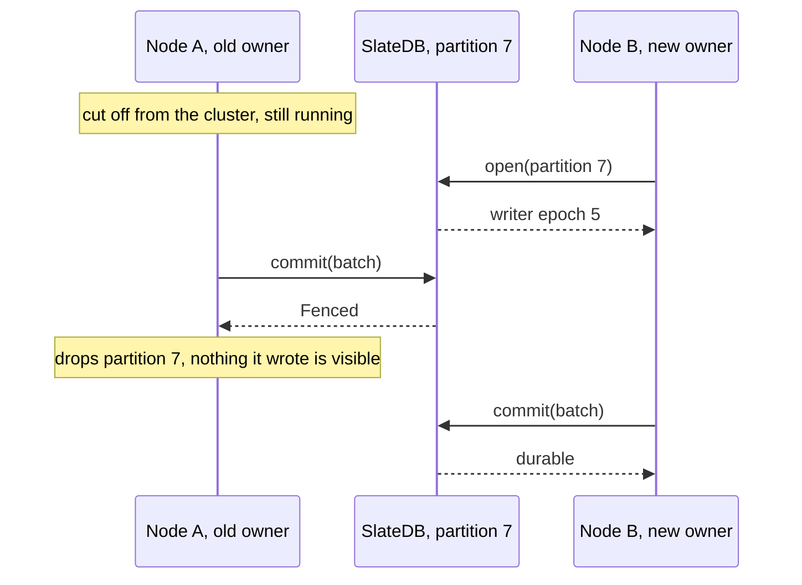
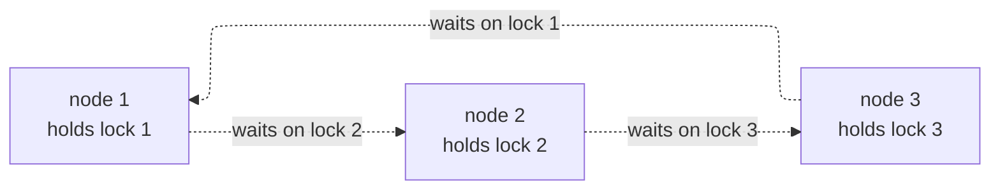
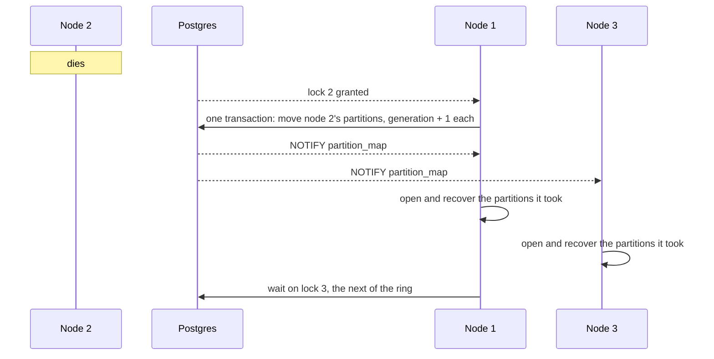
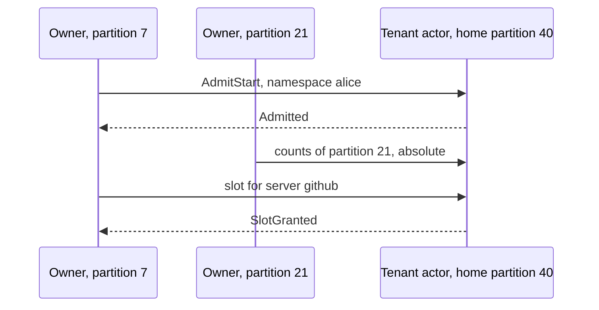

## Partitions

The run plane is cut into a fixed number of **partitions**: 64 in production, 1 on your machine. A partition is one
SlateDB database in the bucket, `partitions/{id}/`, with exactly one writer.



- A **namespace** (one end user of a tenant) gets its partition when it is created, from a hash of its tenant and name.
  The choice is kept in its row and never changes.
- **Every run of a namespace lives in that partition.** A run only reaches runs of its own namespace: the child runs it
  starts, the runs it signals, the runs that watch its end. So everything a run causes on another run is written in the
  same batch as its cause. Nothing crosses partitions, and nothing needs a distributed transaction.
- Idempotency keys, run lists and counters of a namespace stay in one place.

More partitions only serve namespaces created after them, so the count is fixed once a deployment holds runs.

### A run id names its partition

A run id is a UUID of version 8, laid out like a version 7, with the partition in the 16 bits after the variant:

| Bits | 48 | 4 | 12 | 2 | 16 | 46 |
| --- | --- | --- | --- | --- | --- | --- |
| Holds | Milliseconds since 1970 | Version `8` | Process number and counter | Variant | **Partition** | Random |

Any node finds a run's partition from its id alone, and so from anything that carries the id: a call token, a signal
URL's token. Ids sort by time, and the 12 bits after the time make the short run handles unique
(`alice/triage/01jc8f2z9k4m`).

## One owner per partition

Each partition has one **owner**, a node that is its only writer. The **partition map** in Postgres says which node owns
which partition:

```text
partitions (id PK, pool, node, generation)    -- generation: raised each time the partition moves
nodes      (id PK, address, build, epochs, pool, executors_only, joined_at)
```

Partitions go to nodes by **rendezvous hashing**: when a node joins or leaves, only the partitions that must move move.
Every node caches the map and drops it on `NOTIFY partition_map`.

### Fencing

Opening a partition **fences** its previous writer: SlateDB raises its own writer epoch in the database's manifest, and
any later commit of the old writer fails. An owner whose commit is refused this way drops the partition at once.



Correctness never depends on noticing that a node died: a node that believes it still owns a partition simply cannot
commit. Only the time it takes another node to take over depends on detection.

## Liveness without heartbeats

A node writes nothing to say it is alive. Each node holds a Postgres **session advisory lock** on its own id, on a
connection of its own, for as long as it lives. The nodes form a ring, and each one waits on the lock of the next.



When a node dies, its session ends and Postgres grants its lock to the node waiting on it. A process that dies frees its
lock at once; a machine that vanishes, once TCP keepalive gives up, in about 10 seconds.



The locks live in a database of their own on the Postgres server (`postgres` by default), where nothing else is stored.
A node whose lock connection fails gives its partitions up at once.

### Joining and leaving

| Event | What happens |
| --- | --- |
| A node starts | It takes its lock, writes its `nodes` row with the determinism epochs its build supports, and takes some partitions from the others |
| A node stops | It hands its partitions over to the others, then leaves the ring |
| A node dies | The node waiting on its lock moves its partitions |
| A deploy | The old node hands over and stops, the new one joins: about 10 seconds without an owner for its partitions on a single-node deployment |

## Recovery

An owner that opens a partition reads it **once**:

| It reads | And then |
| --- | --- |
| The runnable runs: an inbox not empty, not quarantined, not ended | Queues them, counting one more unfinished activation each, since one may have been running when the previous owner died |
| The timers due within the next hour | Loads them into its timer wheel; those already past fire at once |
| The calls that were ready, deferred or waiting for an approval | Treats every ready call as interrupted, since it cannot know which ones had left: delivers it again with the same idempotency key under `idempotent: true`, or fails it with `outcomeUnknown` under `idempotent: false`. The others keep waiting |
| The outbox | Hands the projections what was not exported or delivered |
| The attempts that ended and are not sealed | Hands them to the sealer |
| The counters | Reports them to the tenant actors |
| The tenant states homed here | Starts those tenant actors |

Nothing is read again on a timer afterwards. From then on, the partition changes only through the owner's batches.

## Routing

The router of the edge finds a run's owner from the partition map. The owner may be on the same node, reached by a
channel, or on another node, reached by the **node link**.

| Node link route | Carries |
| --- | --- |
| `POST /link/call` | A request for an owner (start, signal, cancel, fork, a call's answer, reads), or for a tenant actor (admission, counts, slots, harness actions' calls) |
| `POST /link/activate` | An activation for a remote executor: what the executor needs, and the result back |
| `POST /link/subscribe` | A stream of `Changed` messages for a run, a namespace or a tenant, as server-sent events |

The link is HTTP/2 without TLS on the private network, one connection per node, every request carrying the cluster's
secret and the link's version. An owner that no longer holds the partition answers `NotOwner`; the router reads the map
again and tries once more.

## Tenant actors

Some decisions belong to a tenant, not to a partition: how many runs it has active, how many calls it has in flight to
each MCP server, which worker gets the next call of a harness action. Each tenant has one **tenant actor**, on the owner
of its **home partition**, chosen from the tenant's id.



- It admits starts one at a time, from the sum of the counts each owner reports and the starts it admitted since, so two
  starts never take the same last place, without a lock.
- Owners send their counts as absolute values after each batch that moved them: a lost message is corrected by the next.
- What it keeps is written in its home partition, like any other record. When the home partition moves, the new owner
  starts the actor again and every owner reports its counts once.

## Remote executors

An owner runs an activation on its own node when the node's build supports the run's
[determinism epoch](/engineering/runs#determinism-epoch). Otherwise it sends it over the node link to a node that does,
always the same one while it lives, so the instance stays warm there.

| Case | Where the activation runs |
| --- | --- |
| The run's determinism epoch is supported by this build | This node's executors |
| A run of an older epoch, after an upgrade of V8 | An `--executors-only` node of the previous build, kept up until those runs end |
| A tenant with its own pool | A node started with `--pool <name>` |
