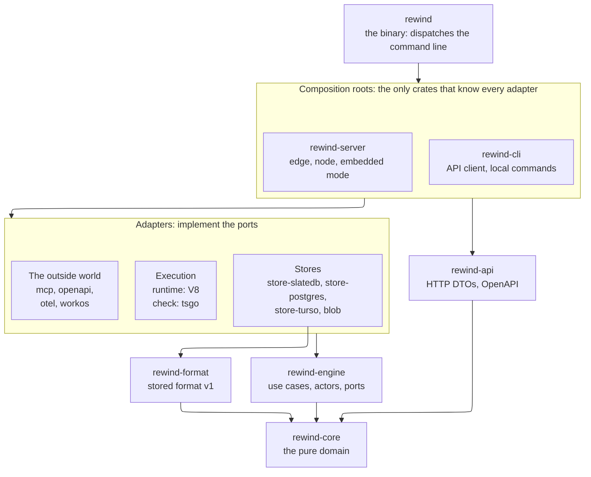

Rewind's server is a Rust workspace with a hexagonal layering: a pure domain, an application layer that declares
**ports**, **adapters** that implement them, and **composition roots** that wire everything. The whole of it ships as
one `rewind` binary.

## Layers



Dependencies only point down, and adapters never depend on each other.

| Layer | Crates | Holds |
| --- | --- | --- |
| Domain | `rewind-core` | Events, the history, `ReplayCursor` (the determinism check), `RunState`, payload identity and canonical JSON, the pinned action set, run ids and handles. No I/O, no async, no V8, no serde: it does not know how events are stored |
| Application | `rewind-engine` | The use cases (start, activate, signal, cancel, replay, fork, seal, erase), the actors of a node, the ports as traits, an in-memory adapter of every port, the driver with its virtual clock, the conformance suites |
| Adapter support | `rewind-format`, `rewind-api`, `rewind-outbound`, `rewind-codegen`, `rewind-agent-tools`, `rewind-mcp-server` | The stored format; the HTTP DTOs; the egress checks and JWT signing; JSON Schema to TypeScript; the agent tools; Rewind's MCP server |
| Adapters | `rewind-runtime`, `rewind-store-slatedb`, `rewind-store-postgres`, `rewind-store-turso`, `rewind-blob`, `rewind-mcp`, `rewind-openapi`, `rewind-check`, `rewind-otel`, `rewind-workos` | V8, SlateDB, Postgres, Turso, S3 and files, MCP, OpenAPI, tsgo, OpenTelemetry, WorkOS |
| Composition roots | `rewind-server`, `rewind-cli` | The wiring of each adapter, picked by configuration; the HTTP API (axum), the node link, the embedded server; the CLI's commands |
| Tooling | `rewind-architecture-tests`, `rewind-e2e`, `evals` | Dependency rules, the epoch corpus, the eval suite |

## Ports

The engine never names Postgres, SlateDB, S3, V8, MCP or OpenTelemetry. It declares what it needs from the outside
world as traits, and is generic over them: composition roots pick the concrete types, with static dispatch.

| Port | Responsibility | Adapters |
| --- | --- | --- |
| `PartitionStore` | One partition, one writer: runs, histories, inboxes, calls' tasks, timers, payloads, the run index, counters, the outbox; fencing | Memory, SlateDB |
| `CatalogStore` | Code, action sets, workflows with their versions and suites, tests, tenants, namespaces, subscriptions | Memory, Turso, Postgres |
| `AccessStore` | Keys, tokens, roles, grants, connections | Memory, Turso, Postgres |
| `SecretStore` | Secrets and signing keys, encrypted at rest | Memory, Turso, Postgres |
| `Cluster`, `NodeLink` | Membership, the partition map, control-plane changes; messages between nodes | Memory and in-process; Postgres and HTTP/2 |
| `RunArchive`, `BlobStore` | Sealed attempts; payloads above 64 KiB and test documents | Memory, files, S3 |
| `CodeExecutor` | Start code, hand it completions and signals, report what it emitted | V8; a fake in engine tests |
| `ActionDispatcher` | Execute a call with its idempotency key and its authentication | Rules and cassettes, TypeScript handlers, MCP, OpenAPI |
| `TypeChecker` | Type-check code against the sandbox and an action set | Static, tsgo |
| `IdentityProvider` | Sign-in, people, organizations, memberships | Memory, WorkOS |
| `SpanExporter`, `WebhookSender` | Run telemetry; webhooks | Memory; OpenTelemetry; HTTP |
| `Clock`, `Entropy` | Time; run ids, workflow ids and seeds | System, virtual; system, seeded |

Every port with state ships a **conformance suite** in `rewind-engine`, and every adapter passes it: the in-memory
adapter is the reference implementation of its contract. Ports follow the domain's invariants, not keys: "a trigger is
committed with everything it caused" is one method, `PartitionLog::commit(batch)`, and the engine never composes a key.

```rust
// The shape of a port, simplified.
pub trait PartitionLog: Send + Sync {
    /// Atomic and durable when it returns; `Fenced` once another node opened the partition.
    fn commit(&self, batch: Batch) -> impl Future<Output = Result<(), PartitionError>> + Send;
    /// The events of an attempt from position `from`. Empty once the attempt is sealed.
    fn history(&self, run: &RunRef, attempt: Attempt, from: u64)
        -> impl Future<Output = Result<Vec<HistoryEvent>, PartitionError>> + Send;
    // inbox, tasks, payload, timers, search, counters…
}
```

## Boundaries own their representation

Domain types never leak through a boundary. Each boundary has its own types, converted at the edge:

| Boundary | Owner | Why apart |
| --- | --- | --- |
| Stored format | `rewind-format`, versioned `"v": 1` | Runs stay paused for days across deploys: what is stored must stay readable while domain types change |
| HTTP and SDK | `rewind-api` | A public contract, versioned `/v1` |
| Between nodes | The node link's DTOs in `rewind-server` | Internal to a deployment |
| JavaScript and Rust | `rewind-runtime` | Internal to the sandbox, shaped for the glue |

## Rules the build enforces

`rewind-architecture-tests` reads `cargo metadata` and the sources, and fails the build when a rule breaks:

- Every crate is classified in a layer. `rewind-core` depends on no internal crate and on a short list of external ones.
  `rewind-engine` depends only on `rewind-core`. Adapters never depend on each other. Only the composition roots depend
  on adapters.
- No `anyhow` in libraries: each crate has its own error types, and adapters convert SlateDB, sqlx, Turso, object store
  and V8 errors into port errors.
- OpenTelemetry crates only in `rewind-otel`; `rewind-core` has no telemetry at all.
- **No polling**: `tokio::time::interval` and `sleep` appear only in the timer wheel, the backoff helpers and the few
  clocks that read no store.
- **No `unsafe`** anywhere but the `memory` module of `rewind-runtime`, for what V8 offers only through raw pointers,
  every block documented.

## Tests

| Where | What |
| --- | --- |
| `rewind-core` | The pure model: canonical JSON against RFC 8785 vectors, `ReplayCursor`, run state |
| `rewind-format` | Golden fixtures: a stored v1 document must always decode |
| `rewind-engine` | Use cases and actors in the driver, with in-memory adapters, a fake executor and virtual time: idempotency, quarantine, recovery after a node dies, a partition moved, an owner fenced mid-batch, fairness, quotas |
| Adapters | Each passes the conformance suites of its ports: SlateDB on memory, files and MinIO; Postgres with two processes' locks and notifications |
| `rewind-runtime` | The sandbox driven by the engine: `Promise.all`, time, randomness, limits, the exact set of globals, how a run ends |
| `rewind-e2e` | The epoch corpus: recorded scenarios, blue (must succeed) and red (must fail exactly as specified), each replayed from its committed history byte for byte |
| `rewind-server` | Several nodes over Postgres and MinIO: a node killed during an activation, a node joining and leaving, the node link, the streams |
| `acceptance/` | The release gate: the real binary, Postgres, MinIO, an OpenTelemetry collector, a real MCP server, the dashboard in a browser |
