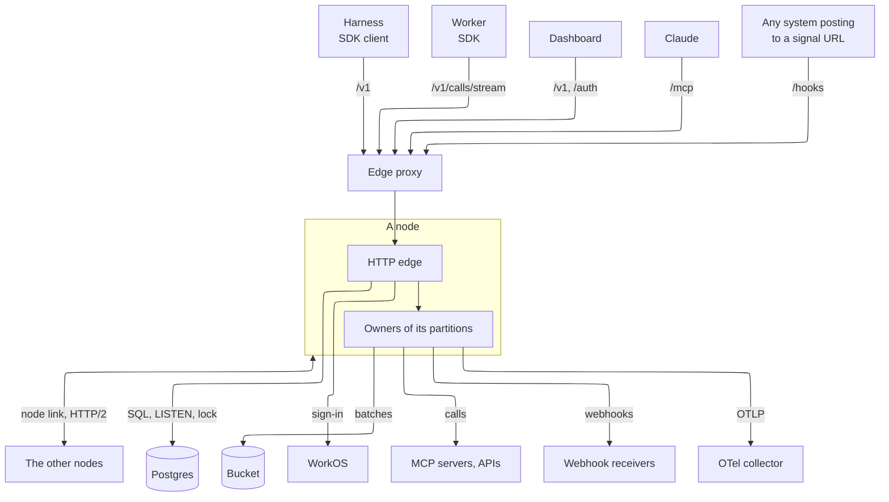
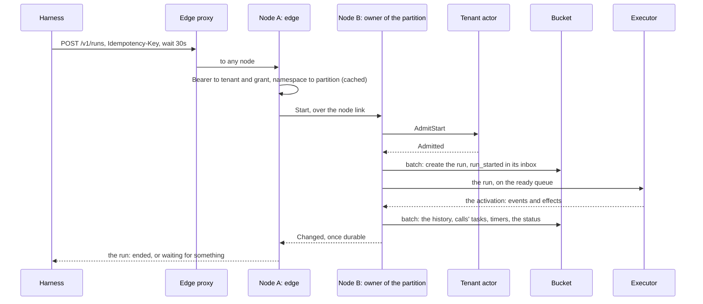

## The map

Clients only ever reach the **HTTP edge** of a node, through the edge proxy. Behind it, nodes talk to each other over
the **node link**, to Postgres for configuration, to the bucket for runs, and to the outside world for calls and
webhooks.

Every node is the same: the proxy may pick any of them, and a request about a run that another node owns crosses the
node link.

## Every link

| From | To | Protocol | Authenticated by | Carries |
| --- | --- | --- | --- | --- |
| Harness, CLI | Edge | HTTPS, JSON, `/v1` | An API key `rewind_sk_…` or an end user's token, as Bearer | Starts, signals, cancels, reads |
| Worker | Edge | `GET /v1/calls/stream` (server-sent events), answers by `POST /v1/calls/{token}/…` | A key or a token with `calls:work` | The calls of harness actions handed to the worker |
| Dashboard | Edge | `/auth` (a sealed cookie), `/v1` and `GET /v1/changes` | A WorkOS access token, as Bearer | Sign-in, reads, the change stream, a run's event stream |
| Claude | Edge | `POST /mcp`, MCP over Streamable HTTP, without session | A connection's token `rewind_ct_…` from Rewind's own OAuth server | The agent tools |
| Any system | Edge | `POST /hooks/{token}`, a signal URL | The unguessable token in the URL | A signal for a run |
| Edge proxy | Nodes | HTTP | None: private network | Every request, to any node |
| Node | Node | The node link: HTTP/2 without TLS on the private network, JSON | The cluster's shared secret, and the link's version | Requests to an owner, activations for a remote executor, subscriptions to changes, messages to tenant actors |
| Node | Postgres | SQL | Database credentials | The control plane; `LISTEN` on its changes and the partition map; a session lock that is the node's liveness |
| Owner | Bucket | The S3 API, through SlateDB and `object_store` | A cloud key | Its partitions' write-ahead log and tables; sealed attempts; payloads above 64 KiB |
| Edge | WorkOS | HTTPS | WorkOS's API key | Sign-in, people, organizations, memberships, invitations; the keys that check access tokens |
| Owner's node | MCP servers, APIs | MCP over Streamable HTTP, or HTTP | A secret the run uses, or a JWT signed with the tenant's Ed25519 key | Calls, with their idempotency key and trace context |
| Edge | MCP servers, APIs | The same | The same | At registration: listing an MCP server's tools, reading an OpenAPI document |
| Owner's node | Webhook receivers | HTTPS `POST` | A Standard Webhooks HMAC signature | Webhooks: `run.completed`, `run.waiting`… |
| Every node | OTel collector | OTLP over gRPC or HTTP | Your collector's | Run spans projected from histories, service spans, logs, metrics |
| Your servers | Edge | `GET /organizations/{tenant}/jwks.json` | None | The public keys that check signed calls |

## A request's path

Every node serves the whole API, so the edge proxy may send a request to any of them. The node that receives it
authenticates it, then finds who must answer: the control plane for configuration, the **owner** of a run's partition for
anything about a run.

- The edge never writes a run. It finds the owner in the **partition map**, cached and dropped when Postgres announces a
  change. An owner that no longer holds the partition answers `NotOwner`, and the edge reads the map again.
- The owner answers the start once its batch is durable. With `wait`, the edge stays subscribed to the run and answers
  when the run ends or the wait elapses.
- The tenant actor may live on a third node: each tenant has one, on the owner of its home partition.

## Who reads and writes what

| | Postgres | Bucket |
| --- | --- | --- |
| HTTP edge | Reads keys, grants, namespaces, action sets, workflows (cached); writes configuration | Reads sealed attempts and blobs: immutable, cached forever |
| Partition owner | Reads what its runs need (code, action sets, secrets for the dispatcher) | The only writer of its partition; writes the archive when a run ends |
| Node actor | Its liveness lock, the partition map, its `nodes` row | Opens and closes partitions |

The **owner is the only writer** of its partition. Two nodes never write the same partition, and nothing but an owner
writes a run.

## Push, never poll

No piece asks another "anything new?" on a timer. Every change travels as a message, sent once the fact behind it is
durable.

| Change | Pushed by | To | Over |
| --- | --- | --- | --- |
| A setting changed (a key, a grant, a secret, a workflow…) | The writing transaction | Every node | `NOTIFY control_plane` |
| A partition moved | The node that moved it | Every node | `NOTIFY partition_map` |
| A node died | Postgres, releasing its lock | The next node of the ring | A lock granted |
| A run changed | Its owner, after its batch | The edges subscribed to the run, its namespace or its tenant | Channel, or the node link |
| A harness action's call is ready | The tenant actor | The edge that holds a worker's call stream | The node link, then server-sent events |
| A run ended, or waits on the outside world | Its owner, through the outbox | Your webhook receivers | HTTPS |
| A timer is due | The partition's timer wheel | Its owner | Channel |

The details are on [fan-out and streams](/engineering/fan-out).

## What reaches outside

A deployed node calls the outside world only for a tenant: its MCP servers and APIs, its `http` action's hosts, its webhook
receivers. Every such connection goes through the same egress checks: the name is resolved once, private, loopback,
link-local and cloud-metadata addresses are refused, and the connection goes to the address that was checked. The
[actions page](/engineering/actions#egress) lists them. In the reference deployment, an egress gateway also stands
between the nodes and the internet, and forwards only to the names an operator allowed.
