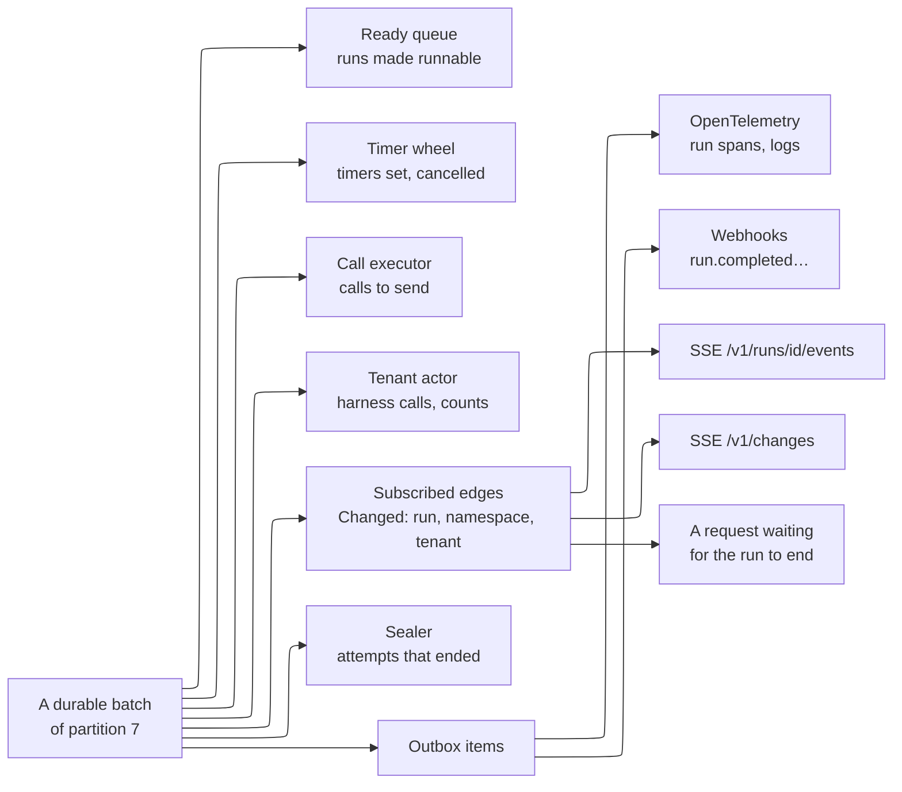
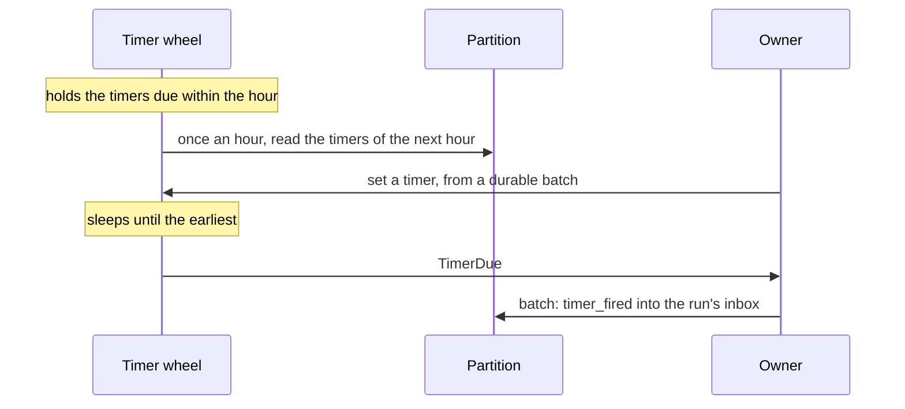
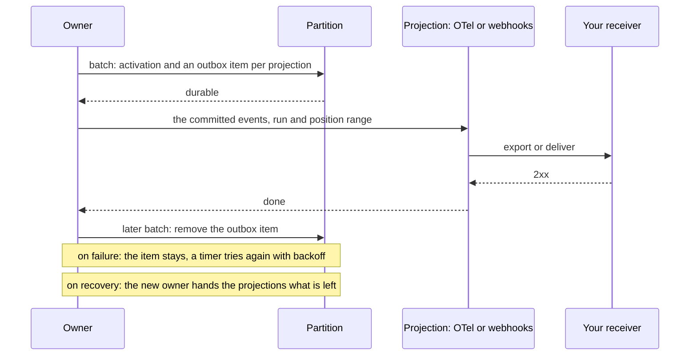
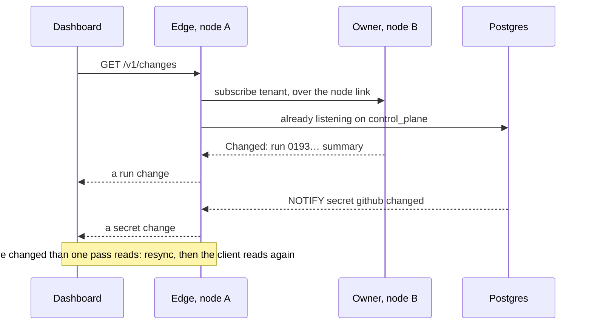

## One fact, many consumers

Everything starts with a **durable batch**. Once the owner's committer says a batch is in the bucket, the owner fans out
what follows from it. Nothing leaves before, so no consumer ever hears about something that could still be lost.

| Kind | What fires it | Who hears it | Delivery |
| --- | --- | --- | --- |
| **Triggers** | A call's result, a timer, a signal, a cancellation | The run, through its inbox | Exactly once into the history, by the commit invariant |
| **Timers** | The timer wheel of the partition | The owner | Rebuilt from the partition at recovery |
| **Changed** | The owner, after each batch | Edges subscribed to a run, a namespace or a tenant | At most once: a lost message is followed by a re-read |
| **Outbox items** | The owner, in the batch of the fact | OpenTelemetry, your webhook receivers | At least once, idempotent |
| **Control-plane changes** | The writing transaction in Postgres | Every node | `NOTIFY`, then caches dropped |
| **Harness actions' calls** | The tenant actor | One worker's call stream | Handed out with a call token; delivered again if the stream closes for good |

## Triggers: how the outside reaches a run

A run moves only when a trigger lands in its inbox. Every source ends the same way: a batch with `Enqueue`, then the run
queued once that batch is durable.

| Source | Arrives at | Becomes |
| --- | --- | --- |
| A call's result or failure | The call executor, or `POST /v1/calls/{token}/complete` for a harness action | `call_completed`, `call_failed` |
| A timer due | The partition's timer wheel | `timer_fired` |
| `POST /v1/runs/{id}/signals/{name}` | Any edge, routed to the owner | `signal_received`, deduplicated by its `Idempotency-Key` |
| `POST /hooks/{token}`, a signal URL | Any edge: the token names the run | `signal_received` for the name given to `signalUrl()` |
| Another run's end | The owner, in the batch of that end | `signal_received rewind:ended:<id>` |
| `POST /v1/runs/{id}/cancel`, the deadline | The owner | `cancel_requested` |

## Timers

Timers are records of the partition, sorted by due time: the code's timers, call timeouts, redelivery backoffs,
deferred-call deadlines, run deadlines, the end of retention, a webhook's next try.

The wheel is the only loop of the run plane. Everything else waits on a channel.

## The outbox

What leaves the partition for the outside world goes through its **outbox**: span batches for OpenTelemetry, webhooks,
and `quota.alert`.

- **At least once.** An export or a webhook can repeat after a crash. Every projection is idempotent: spans have
  deterministic ids, and so does every webhook.
- **One item per projection,** so a slow OpenTelemetry backend never delays a webhook.
- **A webhook that fails is sent again** with backoff, each next try a timer of the wheel. Its item stays until the
  webhook is received or given up.

## Webhooks

Your subscriptions (`POST /v1/subscriptions`) list the `types` of webhook they receive:

| Type | Fired when |
| --- | --- |
| `run.completed` | An ending batch with `complete_run` |
| `run.failed` | An ending batch with `fail_run` |
| `run.cancelled` | A run ended by a cancellation |
| `run.aborted` | An ending batch with `run_aborted`: a limit, the engine giving up |
| `run.waiting` | A batch left the run `waiting` on the outside world: a signal, a harness action, an approval, a parked call. A timer alone sends nothing |
| `run.quarantined` | The owner quarantined the run |
| `action.schema_changed` | A call was parked because the action's schema changed |
| `secret.expired` | A call was parked: its server refused the secret or signature (`refused`), or the secret is gone (`missing`) |
| `quota.alert` | An end user, or the organization, crossed 80 % or 100 % of a quota (from the tenant actor's partition) |

Each delivery is a `POST` of `{ type, timestamp, data }`, signed following [Standard Webhooks](https://www.standardwebhooks.com)
with the subscription's secret: the headers `webhook-id` (the webhook's deterministic id, the same on every try),
`webhook-timestamp` and `webhook-signature`. Every webhook about a run carries the run as the batch left it, its
namespace and its labels. The SDK's `verifyWebhook` checks it all.

## OpenTelemetry

Rewind emits two kinds of telemetry, kept apart:

| | Service telemetry | Run telemetry |
| --- | --- | --- |
| Covers | The platform: activations, replays, batches, partitions taken over, the ready queue, V8 heap, deliveries | What each run's code did: calls, timers, signal waits, logs, outcome |
| Source of truth | The node | The history |
| Emitted by | The `tracing` facade, live | The projector, from durable batches, through the outbox |

Nothing about a run's code is emitted from the isolate or during replay: an activation can replay a whole history, and
telemetry emitted while executing would repeat on every replay.

**One trace per run.** Its trace id is the harness's when it gave a `traceparent` at start (the run then appears under
the model call that wrote the code), and otherwise the run's id.

| Span | Span id | Starts → ends |
| --- | --- | --- |
| Run | `H(run, "run")` | `run_started` → the event that ends the run |
| Activation (service) | `H(run, "activation", idx)`, the position of its first event | Taken from the ready queue → its batch durable |
| Call | `H(run, seq)` | `schedule_call` → its completion |
| Delivery (service) | random | Dispatch → response, child of the Call span |
| Timer | `H(run, seq)` | `start_timer` → `timer_fired` or `cancel_timer` |
| Signal wait | `H(run, idx of signal_awaited)` | `signal_awaited` → `signal_received` or timeout |

`H` is a truncated SHA-256: a span exported again after a crash is the same span, and live service spans can name the spans
projected from the history as parents before those are exported. Payloads appear as digest, size and preview, never as values.

## Server-sent events

Three streams stay open between a node and its clients. Each is fed by subscriptions at the owners, never by polling.

| Stream | Events | Fed by |
| --- | --- | --- |
| `GET /v1/runs/{id}/events` | `event`: each event of the history from a position, then with `follow` each new one; `end`: the run ended | The run's owner pushes the events of each durable batch |
| `GET /v1/changes` | Changes: `run` (the run's summary, as in a list), `workflow`, `secret`, `namespace`, `connection`, `resync` | Owners of the scope's partitions push `Changed`; Postgres pushes control-plane changes |
| `GET /v1/calls/stream` | `call`, `gone` | The tenant actor hands out the calls of harness actions |

- The edge filters every message by what the caller may see: an end user's namespace, a grant's labels.
- `/v1/changes` has no resume cursor: after a drop, the client reads again what it shows. A run's event stream resumes
  with `from`.
- A stream closes when its credential stops holding: the access token expires, a key is revoked, a grant no longer
  gives the permission. Rights are read again when the control plane says something of the tenant changed, never on a
  timer.

## Control-plane changes

Every write to the control plane sends what it changed in the same transaction, `NOTIFY control_plane` on Postgres. Every
node listens:

| Change | What the nodes do |
| --- | --- |
| A key, a token, a grant, a role, a connection | Drop the cached credential; close the streams it no longer allows |
| A namespace (limits, display name, deletion) | Drop the cached namespace; its owner starts erasing it when deleted |
| A secret put again | Owners resume the calls parked for it in the runs that use it |
| A workflow (created, named, given a version or a test, promoted, forked, pulled), a subscription | Drop caches; send the matching `/v1/changes` changes |
| The partition map (`NOTIFY partition_map`) | Routers drop their map; nodes open the partitions they took |
