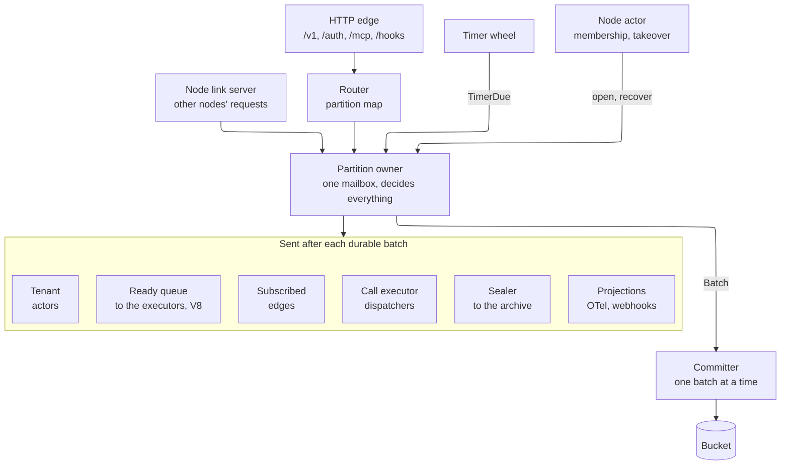
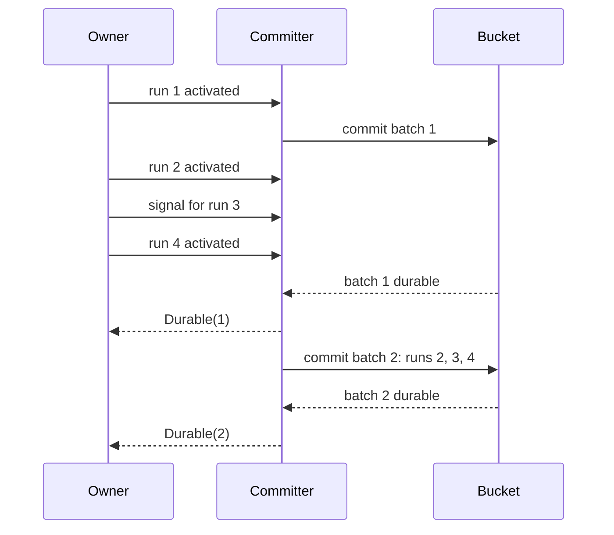

A node is one `rewind server` process. It is both an **HTTP edge**, which serves the API to clients, and a member of the
**run plane**, which owns partitions and executes runs. Inside, the work is split among actors that talk through
channels.

## The actors



Results come back the same way: an executor's activation, a call's result, a tenant actor's answer all land in the
owner's mailbox as messages.

| Actor | One per | Waits on | Does |
| --- | --- | --- | --- |
| **Router** | Node | The edge's requests | Sends a request about a run to the owner of its partition: through a channel when it is in this node, through the node link otherwise |
| **Partition owner** | Partition held | Its mailbox: requests, activation results, call results, due timers | Decides everything about the runs of its partition, derives each run's status, and turns it all into batches |
| **Committer** | Partition held | The batch being filled | Writes the batch to the partition in one commit, then tells the owner it is durable |
| **Timer wheel** | Partition held | Its earliest timer | Tells the owner a timer is due; once an hour, reads the next hour of timers |
| **Sealer** | Partition held | Attempts that ended | Writes an ended attempt's run export to the archive, then asks the owner to clear it from the partition |
| **Executors** | Node | The ready queue, and activations sent by other owners | Run activations in V8 isolates, one thread per instance |
| **Call executor** | Node | Calls that are durable and hold a slot | Sends MCP, API and `http` calls through the dispatchers, and returns their result |
| **Tenant actor** | Tenant homed in a held partition | Its mailbox | Admits starts against quotas, grants the tenant's concurrency slots, hands the calls of harness actions to workers |
| **Node actor** | Node | Its membership, the control plane's changes, a stop | Joins the cluster, opens and recovers the partitions it takes, hands over those it gives |

## Actors do no I/O

Every actor is a **state machine**: it takes a message, changes its state, and returns effects. It never touches a
store, a socket or a clock itself. A task around it carries out the effects.

```rust
// A sketch, simplified from rewind-engine.
trait Actor {
    type Message;
    /// A message in, effects out. No I/O, no clock: `now` is given.
    fn handle(&mut self, message: Self::Message, now: Timestamp) -> Vec<Effect>;
}

enum Effect {
    Commit(Batch),             // to the committer
    Send(Address, Message),    // to another actor, here or through the node link
    SetTimer(Timer),           // to the timer wheel
    Dispatch(Call),            // to the call executor
}
```

This is what makes the engine testable. In tests and test runs, a **driver** steps every actor of every node one message
at a time on a single thread, with in-memory stores and a virtual clock. When nothing is left to do, it jumps the clock
to the earliest timer of the wheels: a `sleep("10d")` takes no time, and a run is reproducible down to the order of its
messages. Killing a node, moving a partition or fencing an owner in the middle of a batch are ordinary test steps.

## Messages after facts

An owner sends nothing before the fact behind it is durable. Its loop looks like this:

```rust
loop {
    let message = mailbox.recv().await;            // a request, a result, a due timer
    let effects = owner.handle(message, clock.now());
    batch.extend(effects.commits());               // filled while the previous batch is written
    // When the committer says a batch is durable:
    for effect in owner.after_durable(batch_id) {
        match effect {
            Runnable(run)      => ready_queue.push(run),
            Timer(t)           => wheel.set(t),
            Call(task)         => call_executor.send(task),   // once it holds a slot
            HarnessCall(task)  => tenant_actor.send(task),    // a harness action's call
            Changed(summary)   => subscribers.notify(summary), // SSE streams, waiting requests
            Ended(attempt)     => sealer.send(attempt),
            Outbox(items)      => projections.send(items),     // OTel, webhooks
        }
    }
}
```

A message is never the only trace of anything. If the node dies, its messages are lost, and the next owner of the
partition rebuilds them from the records: the runs to activate, the timers due, the calls in flight, the outbox
([recovery](/engineering/cluster#recovery)).

## Group commit

The committer writes one batch at a time. Everything that reaches the owner while a batch is being written goes into the
next one. Under load, one write to the bucket carries the activations of many runs; when idle, a batch holds one change
and leaves at once.



## The ready queue and the executors

A run with something in its inbox is **runnable**. The owner puts it on its node's ready queue, unless its build cannot run
the run's [determinism epoch](/engineering/runs#determinism-epoch) or the tenant has its own pool: then it sends the
activation to a node that can, over the node link.

The queue is fair:

1. Tenants with runnable runs take turns, so a large tenant cannot starve the others.
2. Within a tenant, the run with the fewest unfinished activations goes first. A run whose code crashes its node is
   activated after the runs that were only waiting.
3. Then the run whose oldest trigger has waited longest.

Each executor thread takes a run, finds its V8 instance in the **instance cache** or rebuilds it by replay, hands it the
new triggers, and returns what the code emitted to the owner. The [runs page](/engineering/runs) follows an activation
step by step, and [the runtime page](/engineering/runtime) shows what happens inside V8.

## Sizing a node

| Setting | Default | Bounds |
| --- | --- | --- |
| `REWIND_EXECUTORS` | 4 | Activations running at once |
| `REWIND_CALLS` | 256 | Calls in flight from this node |
| `REWIND_CACHE_INSTANCES` | 500 | V8 instances kept warm |
| `REWIND_CACHE_MEMORY` | 4 GiB | Memory of the instances kept warm, as V8 reports it |
| `REWIND_PARTITIONS` | 64 | Partitions of the deployment, fixed once it holds runs |

To run more, add nodes: each takes a share of the partitions, and its executors run their activations.
