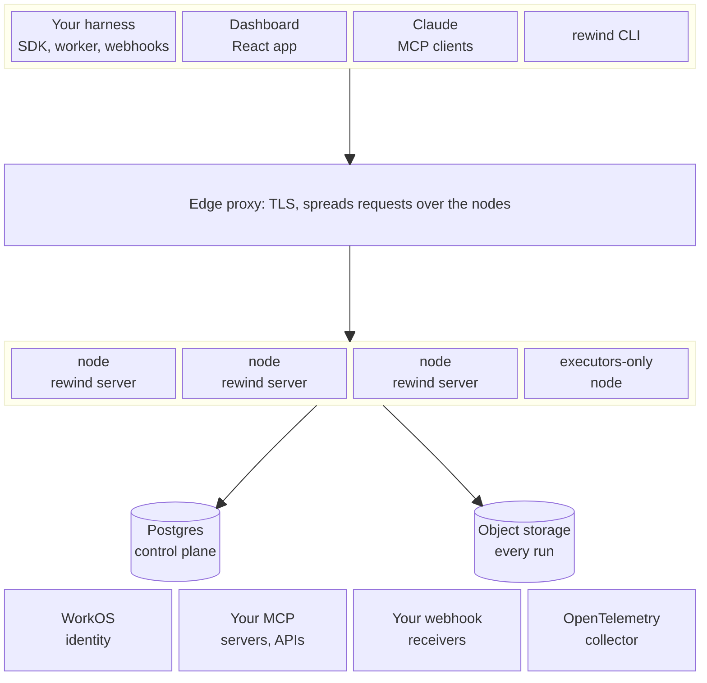
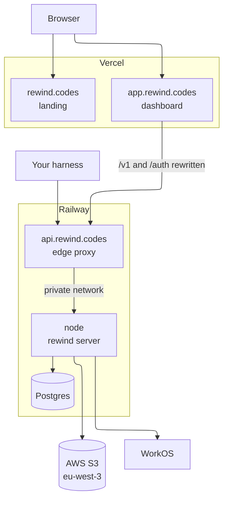

This tab explains how Rewind works inside: for engineers who run it, contribute to it, or want to know what happens to
their runs. It goes from the outside in. This page names the pieces, [the next one](/engineering/connections) shows how
they connect, and the pages after it open each piece.

## Three rules

Every design choice in Rewind follows from three rules.

<CardGroup cols={3}>
  <Card title="The history is the truth" icon="scroll-text">
    Everything a run did is an event of its history. Traces, webhooks, lists, counters and the dashboard are projections
    of it. No feature has a side channel.
  </Card>
  <Card title="Compute is apart from storage" icon="database">
    Nodes hold nothing that cannot be rebuilt. Every run lives in object storage, so any node can die at any moment and
    another takes its work over.
  </Card>
  <Card title="Nothing polls" icon="bell-ring">
    A component waits on a channel and wakes when a message arrives. The one scheduling loop is the timer wheel, which
    reads the next hour of timers once an hour.
  </Card>
</CardGroup>

## The pieces

From top to bottom: the clients, the edge proxy, the nodes that do the work, the two stores, and the services nodes
call. Postgres and the bucket are the only state; every node is the same binary.

| Piece | What it is | What it holds | How it grows |
| --- | --- | --- | --- |
| **Harness** | Your product: the model loop, its prompts, its end users. It uses the TypeScript SDK: an API client, a worker for its harness actions, the agent tools | Its own data | |
| **Dashboard** | A React single-page application over the public API, served by every node and hosted at `app.rewind.codes` | Nothing: it reads the API | |
| **Claude and MCP clients** | Clients of Rewind's MCP endpoint `/mcp`, connected with OAuth | Nothing | |
| **CLI** | The `rewind` binary used as a client of the API. On your machine, it starts an embedded server | `.rewind/` in your project, through its embedded server | |
| **Edge proxy** | A reverse proxy in front of the nodes | Nothing | |
| **Node** | `rewind server`: an HTTP edge and a node of the run plane in one process | Caches only: what it lost is read again from storage | More nodes take more partitions |
| **Executors-only node** | `rewind server --executors-only`: V8 threads, no partition, no HTTP route but the node link | Caches only | For an older determinism epoch, or a tenant's own pool |
| **Postgres** | The control plane, and the nodes' liveness | Tenants, namespaces, keys, grants, roles, workflows and their code, action sets, secrets, subscriptions, the partition map. Never a run | Written at the pace of people |
| **Object storage** | One bucket of an S3-compatible store, or local files | Every run: the partitions (SlateDB databases), the archive of ended runs, large payloads, test documents | As object storage does |
| **WorkOS** | The identity provider | People, organizations, memberships, invitations, the waitlist. Never what someone may do | |
| **Your servers** | MCP servers and APIs your workflows call, webhook receivers that hear about runs | Theirs | |
| **OpenTelemetry collector** | Where traces, metrics and logs go | | |

## One binary

Every Rewind process is the same `rewind` binary. Options at start decide what it takes on.

| Started as | Runs | Used for |
| --- | --- | --- |
| `rewind server` | The HTTP edge, the owners of its partitions, the tenant actors homed there, executors (V8), calls | Every node of a deployment |
| `rewind server --executors-only` | Executors only, for the epochs its build supports | Runs started before an upgrade of V8 |
| `rewind server --pool <name>` | A node of a tenant's own pool: the owners send that tenant's activations there | Isolating a tenant's code |
| `rewind server --embedded` | One node, one partition, Turso and local files, on a unix socket | Your machine: the CLI starts it |
| `rewind <command>` | A client of the API `/v1` | `rewind run`, `rewind check`, `rewind test`… |

## Two planes

Rewind keeps two kinds of data apart, because they live at different speeds.

| | Control plane | Run plane |
| --- | --- | --- |
| Holds | What people configure: tenants, namespaces, keys, grants, roles, workflows and their code, action sets, secrets, subscriptions; the nodes and the partition map | What runs record: histories, inboxes, calls' tasks, timers, payloads, the run index, counters |
| Written | When someone changes a setting | Every activation, in batches |
| Lives in | Postgres (Turso on your machine) | SlateDB partitions in the bucket, then the archive |
| Changes reach the nodes by | `NOTIFY` in the same transaction | The owner of the partition, once its batch is durable |

The [storage page](/engineering/storage) opens both.

## Where it runs

| Deployment | Compute | Control plane | Run plane |
| --- | --- | --- | --- |
| Hosted (`api.rewind.codes`) | Railway: a Caddy edge and one node; the dashboard and the landing on Vercel | Railway's Postgres | AWS S3, in Paris |
| Reference deployment (`deploy/`) | Docker Compose: an edge proxy, two nodes whose only way out is an egress gateway, under gVisor as an option | Postgres 17 | MinIO |
| Embedded (`rewind server --embedded`) | One process on your machine | Turso, in `.rewind/control.db` | SlateDB on local files in `.rewind/` |

The same engine code runs in all three: only the adapters behind its ports change ([code architecture](/engineering/code)).

## Read on

<CardGroup cols={2}>
  <Card title="How the pieces connect" icon="cable" href="/engineering/connections">
    Every link: protocol, authentication, what flows on it.
  </Card>
  <Card title="Inside a node" icon="boxes" href="/engineering/node">
    The actors of a process, and how they never do I/O themselves.
  </Card>
  <Card title="Partitions and the cluster" icon="network" href="/engineering/cluster">
    One owner per partition, fencing, takeover in seconds.
  </Card>
  <Card title="Storage" icon="hard-drive" href="/engineering/storage">
    Postgres, SlateDB on object storage, the archive, payload tiers, key layout.
  </Card>
  <Card title="Runs, activations and replay" icon="rotate-ccw" href="/engineering/runs">
    The history, statuses, the commit invariant, the instance cache.
  </Card>
  <Card title="The TypeScript runtime" icon="braces" href="/engineering/runtime">
    V8 isolates, the glue, ops, determinism, limits.
  </Card>
  <Card title="Actions and calls" icon="wrench" href="/engineering/actions">
    Calls and their tasks, slots, harness actions, secrets and signatures, egress.
  </Card>
  <Card title="Fan-out and streams" icon="radio" href="/engineering/fan-out">
    What follows a durable batch: the outbox, webhooks, OpenTelemetry, SSE, control-plane changes.
  </Card>
  <Card title="Identity and access" icon="key-round" href="/engineering/access">
    Callers, tenants, namespaces, grants, OAuth for Claude.
  </Card>
  <Card title="SDK, dashboard and CLI" icon="app-window" href="/engineering/clients">
    The clients of the API, and the embedded server.
  </Card>
  <Card title="Code architecture" icon="layers" href="/engineering/code">
    Crates, ports and adapters, and the rules the build enforces.
  </Card>
</CardGroup>
