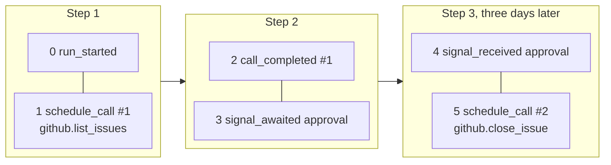
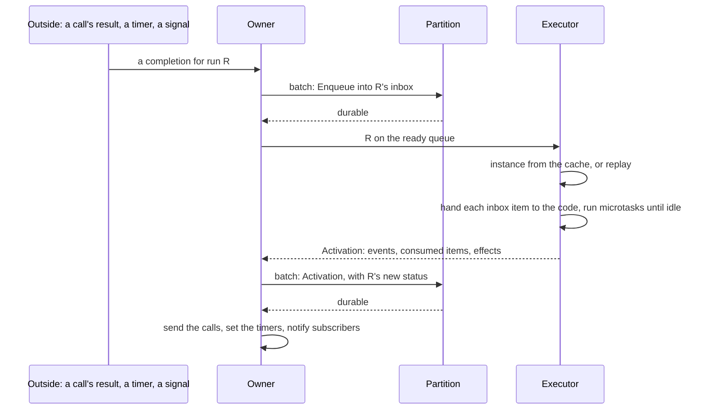
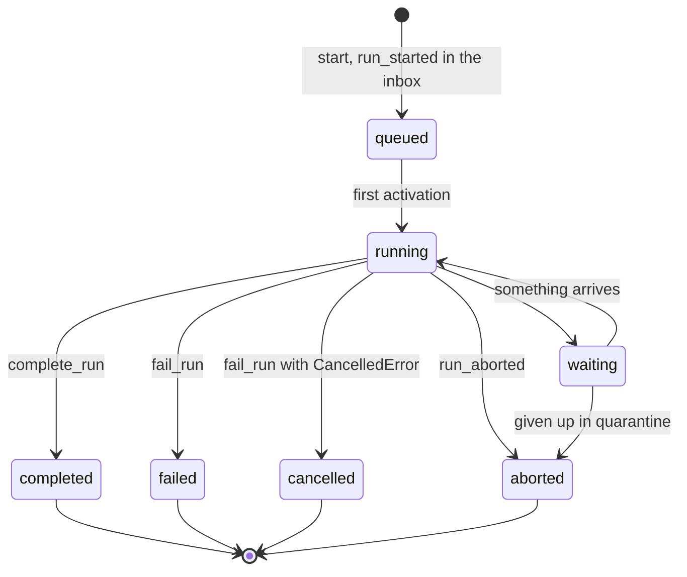
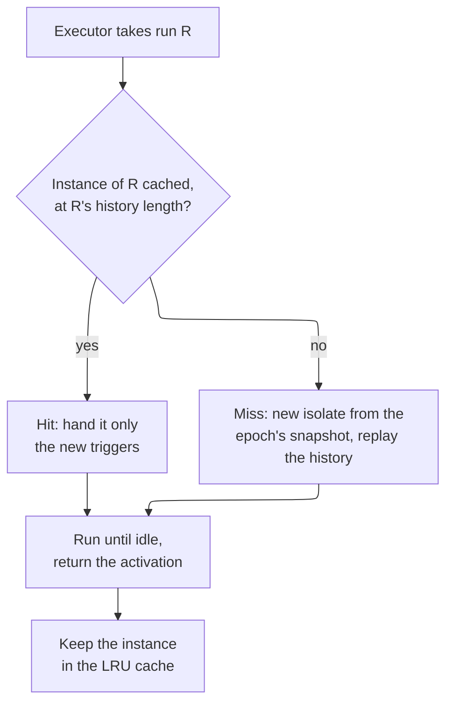

## The history

A run's **history** is an append-only list of **events**. Each event has an index, its position in the history (`idx`),
a `recorded_at` time, and belongs to one of four families:

| Family | Events | Who writes it |
| --- | --- | --- |
| **Lifecycle** | `run_started { code, action_set, input, seed, epoch, expires_at, mode }`, `run_aborted { reason }` | The engine |
| **Commands** | `schedule_call { seq, action, args, callsite }`, `start_timer { seq, duration_ms, fire_at }`, `cancel_timer { seq }`, `complete_run { output }`, `fail_run { error }` | The code: it needs the outside world, or it is done |
| **Completions** | `call_completed { seq, result }`, `call_failed { seq, error }`, `timer_fired { seq }`, `signal_received { name, payload }`, `cancel_requested { reason }` | The outside world: something reached the run |
| **Annotations** | `log { level, message }`, `signal_awaited { name, timeout }` | The code, for observability only |

- `run_started` and every completion are **triggers**: they wake the code up. Commands are what the code does in
  response.
- `seq` numbers commands in the order the code emits them (`#1`, `#2`…). The code is single-threaded and deterministic,
  so the same code fed the same completions gives the same `seq` to the same call, even under `Promise.all`.
- `callsite` is the line of the TypeScript source that issued the command, from the source map: it is what puts a call
  beside its line in the dashboard and in traces.

A history is a list of **steps**: one trigger, then everything the code emitted in response to it. A step is one or
more events, committed whole, and the dashboard's time cursor walks a run step by step.



## From the inbox to the history

Completions never go straight into the history. They land in the run's **inbox**, and only the owner of the run's
partition moves them into the history, one activation at a time. The history has exactly one writer, which is what makes
its order meaningful.



While R's activation runs, new completions keep landing in its inbox. R is queued again once its batch is durable.

## An activation

```rust
// One activation of run R, on an executor.
let run = ready_queue.take();             // fair across tenants
let mut instance = match cache.get(run) {
    Some(i) if i.history_len == run.history_len => i,           // hit: no replay
    _ => replay(executor.start(&run.code), log.history(run)),  // miss
};
let mut events = vec![];
for item in log.inbox(run) {
    let recorded_at = max(clock.now(), run.last_recorded_at);   // monotonic per run
    if run.attempt_ended { continue }                           // late results are dropped
    let emitted = instance.deliver(item, recorded_at);          // V8 runs until idle
    namespace_cpu += instance.cpu_time();                       // metering, never a replay's
    events.push(item);
    events.extend(emitted);
}
let payloads = move_large_payloads_out(&mut events);  // > 1 KiB: records; > 64 KiB: blobs first
let effects  = derive(&events);                        // calls' tasks, timers, cancelled timers,
                                                       // starts and signals of other runs
let status   = derive_status(&run, &effects);          // queued, running, waiting, or its ending
owner.send(Activation { run, events, consumed, payloads, effects, status, summary, counters });
cache.put(run, instance);
```

## The commit invariant

**A trigger is committed in the same batch as everything the code emitted in response to it.** At any point, the history
holds complete steps and nothing else.

- Starting a run only puts `run_started` in the inbox. The first activation commits it with the first commands.
- A call's task is created in the batch that commits its `schedule_call`, and the call is sent only once that batch is
  durable. A crash between the two cannot lose a call or send it twice.
- If a limit stops the activation, the trigger is committed with `run_aborted`, and the commands emitted before the
  abort are dropped with their effects.
- If replay finds a mismatch, nothing is committed.

Replay depends on this invariant: it never meets half a step.

## Run status

Whether a run has ended, and how, is a pure function of its history (`RunState::from_history` in `rewind-core`): it is
queued, active, or ended. The owner splits an active run in two: at each batch, from the waits it already stores (the
calls in flight or waiting, with their states, the timers, the awaited signals, quarantine), it writes the run's status
in its head and summary, which serve every query.



| Status | When |
| --- | --- |
| `queued` | No step committed yet |
| `running` | A step is in progress, or a call Rewind makes itself (MCP, API, `http`) is in flight or backing off |
| `waiting` | Nothing Rewind does can move the run until something arrives: a signal, a timer, a harness action's answer, an approval, a deferred answer, a parked call, a release from quarantine |
| `completed`, `failed`, `cancelled`, `aborted` | The run has ended, as its history says |

- An **active** run has not ended: it is queued, running or waiting. Active is never a status.
- What a waiting run waits for is its `waitingFor`: items of kind `signal`, `timer`, `call` (with the call's state) or
  `quarantined`.
- **Quarantine** is service state in the run's head, never in the history. A quarantined run is `waiting`, for
  `quarantined`: its owner stops activating it until someone releases it or gives it up.

## The instance cache

A run holds no memory while it waits: everything it needs is in its history. But rebuilding the code by replay on every
activation would cost O(history²) over a run's life, so nodes keep instances warm.



- Only the owner of R's partition activates R, so R's next activation runs on the same node and finds its instance.
- The cache is an LRU bounded per node: 500 instances and 4 GiB by default, measured from V8's heap statistics.
- A run misses once when its partition moves or its instance is evicted. Replay is the fallback, not the hot path.
- Histories are capped (50,000 events by default): a run that reaches the cap is aborted.

## Replay

Replay starts a fresh instance, calls `main(input)` with the run's seed, and walks the history with `ReplayCursor`, a pure
function of `rewind-core`:

- When the next event is a **completion**, it is handed to the code and microtasks run.
- Every **command** the code emits must match the next command of the history: same kind, same `seq`, same action, same
  arguments, compared by digest. Callsites are ignored, so moving code without changing behavior is fine.
- If the history expects a command and the code goes idle without emitting it, that is a mismatch too.
- **Annotations** are skipped, and logs are suppressed: they are already recorded. Nothing about the code is exported
  during replay.
- At the end of the history, the code is in exactly the state it was in after its last commit, and continues live.

Mismatches are written to be read by a model:

```text
history event 1 is call #1 github.close_issue({"number":4}), but the code emitted call #1 github.close_issue({"number":5})
history event 4 is timer #2 (3000ms), but the code went idle without emitting it
```

## When an activation fails

| Failure | What is committed | What follows |
| --- | --- | --- |
| The code throws at load, or its default export is not a function | The trigger with `run_aborted { invalid_code }` | The run ends |
| A limit: CPU, heap, emitted commands, history length | The trigger with `run_aborted { limit_exceeded }` | The run ends |
| Replay mismatch | Nothing | The run is **quarantined**: a fault of the platform, never of the code |
| A store error, a missing blob, an internal error | The failure, in the run's head | A timer tries the run again in 30 s; the fifth failure in a row quarantines it |
| The node dies during the activation | Nothing | Counted at recovery as an unfinished activation; above 5, the run is quarantined instead of activated |

A quarantined run is released through the API or the CLI after a fix, and activated again. A node of a new build tries
each quarantined run once more when it opens a partition. At the run's deadline, or when someone gives it up, it ends
with `run_aborted`.

## Determinism epoch

A waiting run is rebuilt by re-executing its code. Everything computed inside the sandbox is computed again, so a new
build of Rewind that computes something differently would break replay. What can change a `seq`, a digest or a value the
code sees:

| Component | Example |
| --- | --- |
| V8 and ICU | `toLocaleString`, `localeCompare`, the text of built-in errors |
| The JavaScript glue | The order in which `signal(name, { timeout })` allocates its timer |
| Random generators | Another algorithm gives another `crypto.randomUUID()` |
| Sandbox globals | A global added or changed |
| Code generation of `rewind:actions` | Another normalization of arguments changes their digest |

These are versioned together by one integer, the **determinism epoch**, recorded in `run_started`. The glue, generators
and generated code are JavaScript embedded in the binary: a build keeps the version of every epoch that may still have
active runs. V8 itself cannot coexist in one process, so after an upgrade of V8, a few `--executors-only` nodes of the
previous build stay up until the runs of the previous epoch end, at most their TTL. A corpus of recorded histories per
epoch is replayed by the test suite: a change that breaks a supported epoch fails the build.

## Timers and deadlines

- `sleep(d)` and `setTimeout` emit `start_timer`. Outside the isolate, a timer is a key of the run's partition, sorted by
  due time, written in the batch that commits the command.
- The owner's **timer wheel** holds the timers due within its horizon, one hour ahead. Once an hour it reads the next
  hour: the one scheduling loop of a partition. When a timer is due, the owner appends `timer_fired` in its next batch.
- Call timeouts, redelivery backoffs, the run's deadline, the end of retention and a webhook's next try are timers of
  the same kind.
- `Date.now()` in the code is its **logical time**, the `recorded_at` of the last trigger handed to it, so after
  `await sleep("10d")` the code sees at least 10 days later.
- Every run has a deadline, 30 days after its start by default. When it fires, the owner enqueues
  `cancel_requested { reason: "ttl" }`. The TTL bounds everything that could wait forever.

## Child runs

A run's code starts and signals runs of workflows through built-in actions (`workflows.triage.start`,
`workflows.triage.signal`), which the engine serves itself. They are calls like any other: recorded, delivered again with
the same idempotency key, answered by a test's world. A start runs the version the run's action set pinned.

The run started is a **child** of the run that started it, its parent. A child's end comes back to its parent, and to
every run that watches it, as the signal `rewind:ended:<id>`. All these runs live in the same namespace, so in the same
partition: the end of a run and the signals it causes are written in the same batch, with idempotency keys that make a
redelivery harmless.

## Forks

`retry_run` forks a run: a new run with corrected code and its **source**'s seed and input. The engine replays the new
code against the source's history. While its commands match, the source's events are copied, results and times
included, and nothing is called again. At the first command that differs, the fork continues live with its own
idempotency keys. A run that failed at step 7 is fixed without redoing steps 1 to 6. When the source runs a workflow
version with a suite, the corrected code must pass that suite first.
