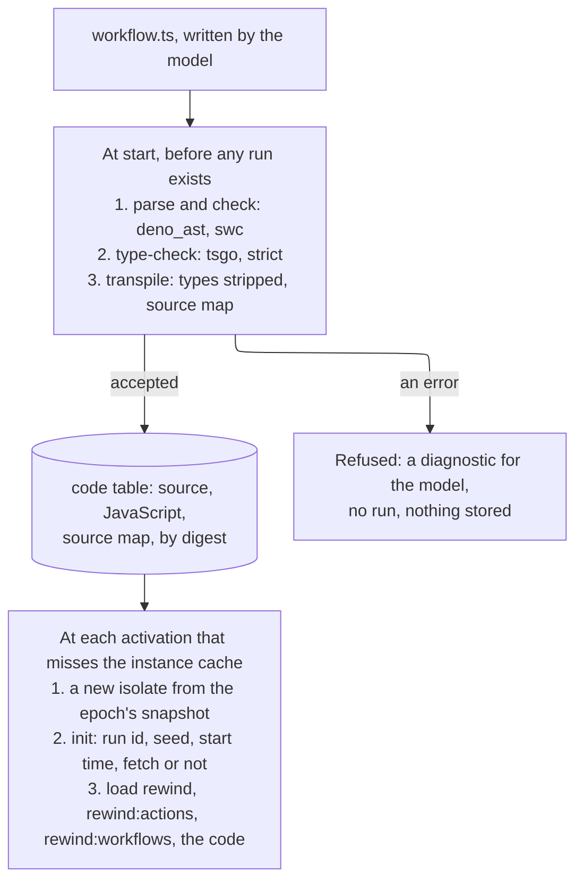
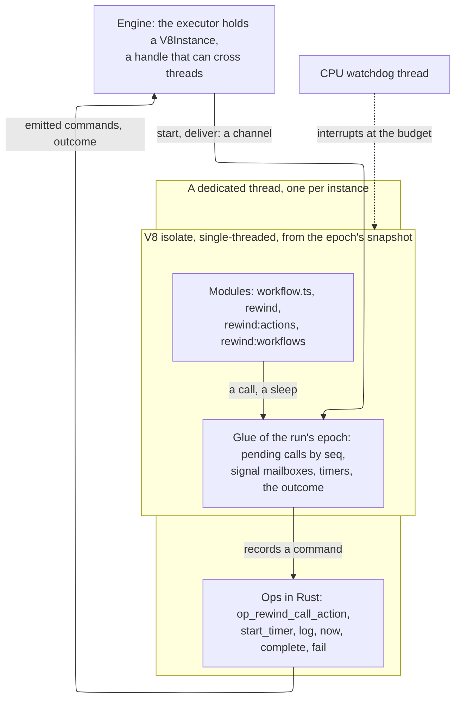
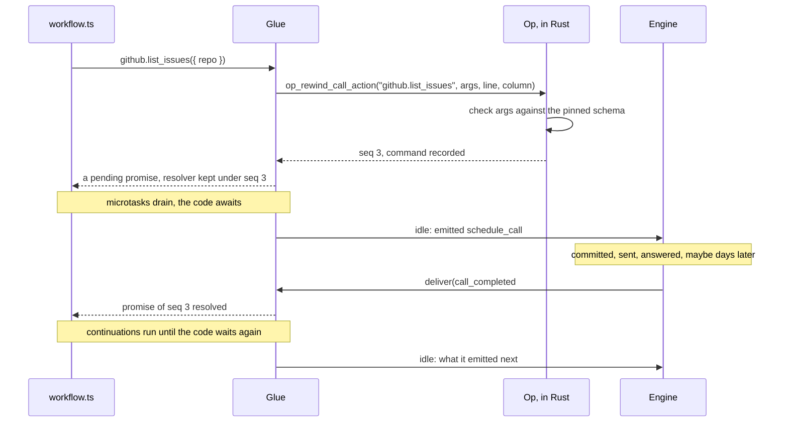
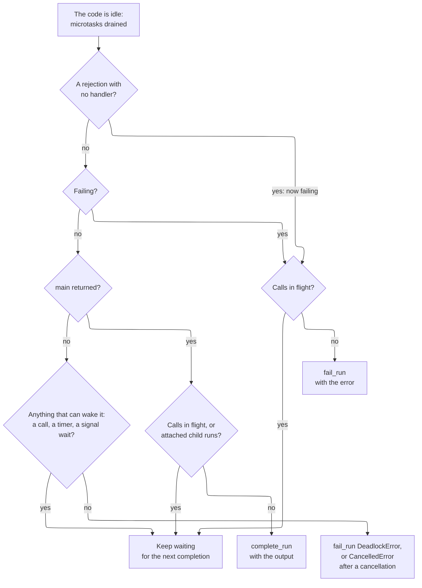

Rewind runs a workflow's code in V8, through `deno_core`, in a sandbox it controls entirely. The runtime
(`rewind-runtime`) **only executes**: it takes code and a start, receives completions, and returns what the code emitted.
It knows nothing about histories, replay, storage or calls: those belong to the engine.

## From source to a running isolate



| Step | Done by | Refuses |
| --- | --- | --- |
| Parse and check | `rewind-runtime` on the swc syntax tree of `deno_ast`, and the engine for quotas and secrets | A syntax error; an import of anything but `rewind`, `rewind:actions`, `rewind:workflows`; a dynamic `import()`, a `require`; an import of an action the action set lacks; no default export; more lines than the namespace allows; a server that needs a secret the run does not use |
| Type-check | `rewind-check`: tsgo, the native TypeScript 7 compiler, embedded in the binary and extracted at first use | Any type error against the sandbox's declarations and the action set's |
| Rules of its own | `rewind-check`, on the same syntax tree | A floating promise (a call neither awaited, returned nor assigned), an `async` callback given to `forEach`, `fetch` or `process` where they do not exist |
| Transpile | `deno_ast`: types stripped, a source map kept | |

Every refusal comes back with a diagnostic written for a model: a line and a column in `workflow.ts`, a message, a
hint, a code frame. No run is created, nothing is stored. Only code that compiles is stored, with its JavaScript and
source map, so a transpiler upgrade never changes a stored run.

## Code generation

An action set is **pinned** when it is registered: the schemas of its MCP tools, its API operations and the workflows it
names are copied into one content-addressed document. From it, `rewind-codegen` derives three things:

| Output | Read by | For `github.list_issues` |
| --- | --- | --- |
| The `rewind:actions` module | The isolate | `list_issues: (args) => call("github.list_issues", args)` |
| `rewind-actions.d.ts` | tsgo | `list_issues(args: { repo: string; state?: "open" \| "closed" }): Promise<Issue[]>` |
| A compact prompt rendering | The model | `github.list_issues({ repo, state? }) → Issue[] · List the issues` |

`github` is the action's **group**: an MCP server, an API, or a set of harness actions. The JSON Schema to TypeScript
converter is Rewind's own, in Rust. When an MCP server declares no output schema, the declarations use the **shape
observed** in the action's past results, marked `@observed`. Observed types serve the type-checker and the prompt only:
they are not part of the action set's digest, so replay never depends on them.

## Anatomy of an instance



- **One thread per instance.** V8 objects cannot change threads, so each instance lives on its own thread, with its own
  single-threaded runtime. The engine talks to it through channels and never touches a V8 type.
- **The web globals** (`URL`, `TextEncoder`, `structuredClone`…) come from `deno_web`, loaded in the snapshot.
- **V8 runs single-threaded** (`--single-threaded`): it compiles and collects garbage on the isolate's thread only. With
  concurrent compilation, the size of stack frames, and so the depth at which recursion overflows, varied between two runs
  of the same code.
- **A startup snapshot per epoch.** The bootstrap (the glue, the deterministic globals, `deno_web`) runs once per node,
  and its state is kept as a V8 snapshot. Every instance starts from it, so a cache miss does not pay for the bootstrap
  again.
- **Per-run setup.** What belongs to one run is not in the snapshot: `init(config)` sets the run id, the logical start
  time, the seeds, and defines `fetch` only if the action set has the `http` action. Then it deletes what the code must
  not reach: `Deno`, the bootstrap's handles, `WeakRef`, `FinalizationRegistry`, `SharedArrayBuffer`, `Atomics`,
  `WebAssembly`.
- **The modules.** The entry module imports `rewind:internal`, which takes the glue's hooks and deletes the global that
  carried them, then imports the workflow's code and hands its default export to the glue. The `rewind:actions` and
  `rewind:workflows` modules are generated for the run's pinned action set by the epoch's own code generation.

## Nothing is asynchronous

From V8's point of view, nothing in the sandbox is asynchronous. There is no event loop and no real timer.

- An **op is synchronous**: it validates, records a command, assigns it a `seq`, and returns the `seq`.
- The glue turns that `seq` into a **promise**, and keeps its resolver in a map by `seq`.
- **Handing over** a completion calls the glue's `deliver(completion)`, which settles the promise of that `seq`, then
  runs a microtask checkpoint: the code's continuations run until it waits again.
- Then the glue's `idle()` decides whether the run has ended.



In pseudo-code, the instance's side of an activation is:

```rust
fn deliver(&mut self, completion: Completion, recorded_at: Timestamp) -> Emitted {
    self.state.now = recorded_at;                  // logical time
    self.watchdog.arm(self.limits.cpu_per_trigger);
    self.glue.call("deliver", completion.to_json()); // settles one promise
    self.isolate.perform_microtask_checkpoint();     // the code runs until it waits
    self.glue.call("idle");                          // ended? deadlock? unhandled rejection?
    self.state.take_emitted()                        // commands, annotations, outcome
}
```

## Determinism

The same code, input, seed and history must always produce the same commands. Every source of non-determinism is
replaced:

| What code could observe | In Rewind |
| --- | --- |
| The clock: `Date.now()`, `new Date()`, `performance.now()`, `Temporal.Now`, `Intl.DateTimeFormat` | Logical time: the `recorded_at` of the last trigger handed to the code |
| `Math.random()` | sfc32, seeded from the run's 256-bit seed |
| `crypto.getRandomValues()`, `crypto.randomUUID()` | ChaCha20, seeded from the same seed: unpredictable, and the same on replay |
| Time zone, locale | `TZ=UTC` (the node refuses to start otherwise), ICU locale `en-US` |
| Garbage collection timing, threads | `WeakRef`, `FinalizationRegistry`, `SharedArrayBuffer`, `Atomics` removed |
| Code the sandbox cannot see | `WebAssembly` removed; no dynamic import, no npm |
| The stack depth | The stack limit pinned at a fixed distance below the call into JavaScript, whatever the Rust frames above |
| The order of a value's keys | Values reach the code with their keys in canonical order, live and on replay alike |
| Timers | `setTimeout`, `setInterval` and `sleep` are durable timers: commands, not wall-clock waits |
| `console.*` | Recorded as `log` annotations, suppressed on replay |

What type-checks is exactly what exists: the sandbox's declaration files (`globals.d.ts`, `rewind.d.ts`, `fetch.d.ts`)
list exactly the isolate's globals, and a test compares the two.

## How a run ends

A run ends when its outcome is known **and no call is in flight**. The glue decides it each time the code goes idle:



- **A forgotten `await` is harmless.** After `main` returns, the code stays alive until its last call settles, so the
  effect it asked for happens, and a failure of that call still fails the run.
- **After a failure, none of the code runs.** The calls in flight are recorded as they arrive, without being handed to
  the code, and `fail_run` follows the last one. When a run ends by itself, every call it made has a recorded outcome:
  this is what tells a fork which effects happened.
- **Unhandled rejections follow Node.** V8 reports every promise rejected without a handler; the glue checks them after
  each microtask checkpoint.
- **The output is captured when `main` returns.** Serializing it runs the workflow's code (`toJSON`, getters), which must
  not happen once the outcome is decided.

## Limits

| Limit | Default | Enforced by | When exceeded |
| --- | --- | --- | --- |
| CPU per call into the code (`main`, or one completion) | 5 s | A watchdog thread that interrupts V8; the interrupt reads the isolate thread's own CPU clock | `run_aborted { limit_exceeded }` |
| Heap | 128 MiB | V8's heap limit and its near-heap-limit callback | `run_aborted { limit_exceeded }` |
| Array buffers | 128 MiB | A capped allocator, outside V8's heap | A `RangeError` the code can catch, deterministic: V8 collects garbage before it gives up |
| Commands and annotations per trigger | 50,000, 64 MiB of text | The ops | `run_aborted { limit_exceeded }` |
| History length | 50,000 events | The engine | `run_aborted { limit_exceeded }` |

The budget is CPU time of the isolate's thread, not wall-clock time, so a loaded machine never makes code exceed it. It
applies per call into the code, not per activation: replaying a long history never exhausts it. The watchdog also
reports each call's CPU time; the engine counts the calls that execute, never those of a replay, toward the namespace's
monthly CPU.

V8 runs some built-ins to their end without an interrupt check, and aborts the process on a few results too large for it.
The node's container bounds that, and a run whose activation kills its node five times is quarantined.

## Epochs in the code

The glue is versioned by [determinism epoch](/engineering/runs#determinism-epoch): `js/epochN/` holds the bootstrap, the
`rewind` module and the entry module of epoch N, frozen once released. A change code could observe (a `seq`, a digest, a
value, a global) goes into a new `js/epochN/`, while the previous epochs stay as they are for the runs that started
under them. Each epoch has its own snapshot, built on first use.

Code written before Rewind's current vocabulary keeps working: the sandbox still resolves `rewind:tools`, `webhook()`,
`ToolError` and `WorkflowError` as `rewind:actions`, `signalUrl()`, `ActionError` and `RunError`. Nothing declares or
documents the old names, so new code never uses them.

## Test runs and virtual time

Tests (`rewind test`, `POST /v1/test`, a workflow's suite) run the same runtime in **test runs** (mode `test`): the engine
with in-memory stores and a virtual clock that jumps to the next timer. Answers to calls come from the test's rules, a
cassette, or TypeScript **handlers**. Handlers run in an isolate of their own, on a thread of their own: nothing they do
can reach the code's isolate, and what they return is recorded like any call's result.
