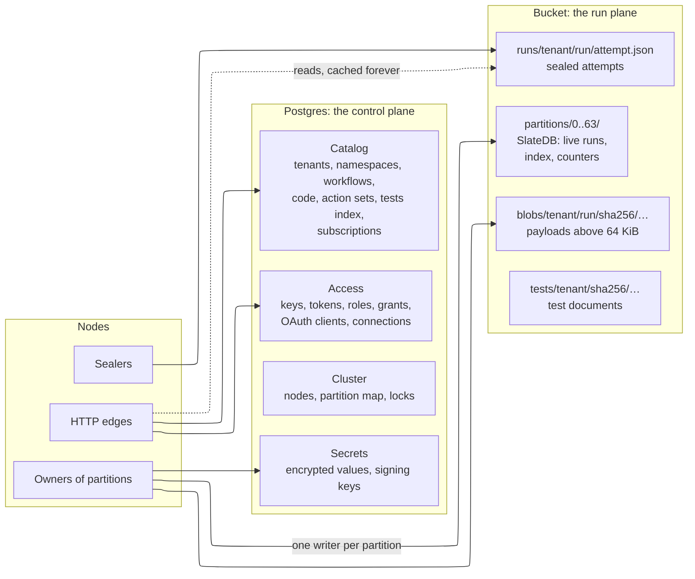
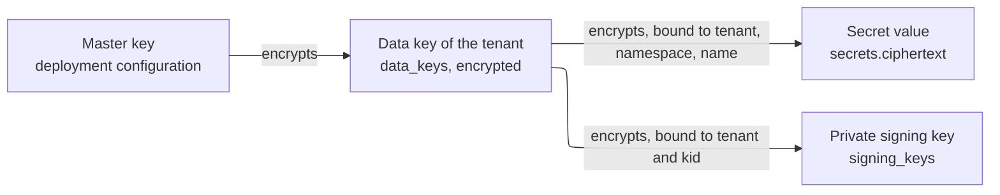
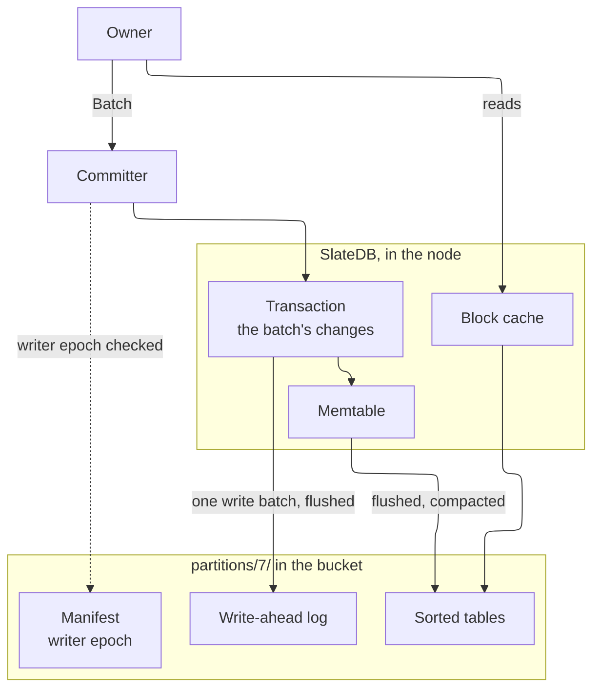
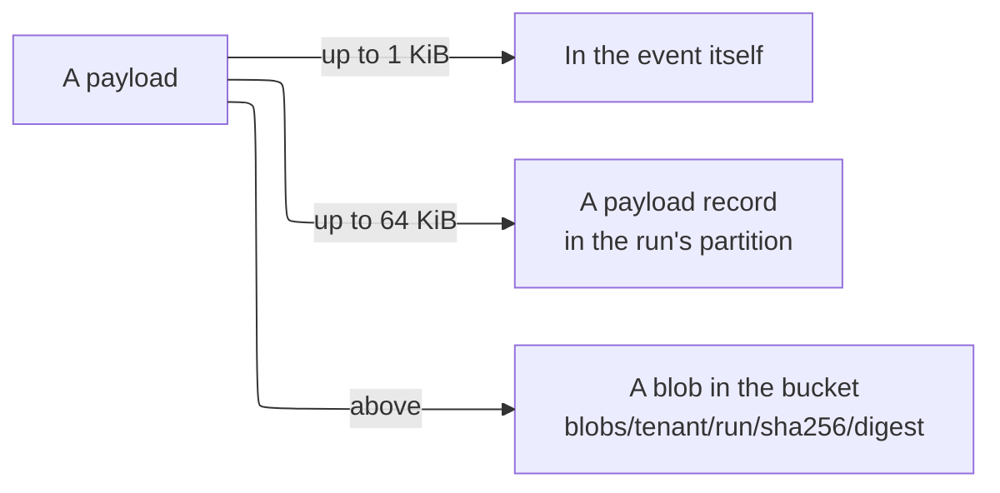
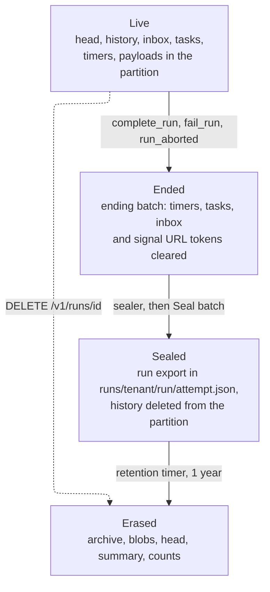

## Two planes, one bucket



| | Control plane | Run plane |
| --- | --- | --- |
| Holds | What people configure | What runs record |
| Store | Postgres in production, Turso on your machine | One SlateDB database per partition, in a bucket or local files |
| Written | When a setting changes | By batches of the partition's owner, many runs per write |
| Readers | Every node, through caches dropped on `NOTIFY` | The owner, and the edges that read the archive |
| Never holds | A run, live or ended | A key, a grant, a secret |

### Written only when a state changes

Nothing is written while nothing happens: no lease renewed, no heartbeat, no queue position, no table polled. A call costs
its run two appends: the call before it is sent, and its result before the code sees it.

## The control plane

The control plane is a handful of tables, grouped by the port that owns them:

| Port | Tables |
| --- | --- |
| `CatalogStore` | `tenants`, `namespaces` (with their partition), `code` (source, transpiled code, source map), `action_sets` (pinned document and declarations), `workflows` (id, scope, name, a fork's source), `workflow_versions` (immutable, numbered per workflow), `workflow_codes`, `workflow_tests`, `tests`, `subscriptions` |
| `AccessStore` | `api_keys`, `tokens`, `token_keys`, `roles`, `grants`, `access_settings`, `oauth_clients`, `oauth_codes`, `connections`, `connection_tokens` |
| `SecretStore` | `data_keys`, `secrets`, `secret_reads`, `signing_keys` |
| `Cluster` | `nodes`, `partitions`, and `legacy_runs` for runs moved from an older design |

- Keys and tokens are stored as the SHA-256 of their secret, never in clear.
- Code, pinned action sets and workflow versions are **content-addressed**: their key is the digest of their canonical
  form, and they never change. A run records the digests it started with, and replays the exact code that produced it.
- A workflow has an id the API draws (`wf_…`) and belongs to a scope: the namespace whose run created it, or the
  organization once a member promotes it. `workflow_codes` maps each code a scope has seen to its workflow, so the same
  code sent again is the same workflow.
- Every write sends what it changed in the same transaction: `NOTIFY control_plane` on Postgres, a broadcast inside the
  process on Turso. Every node listens, and drops what it cached.

### Secrets at rest

Secret values and signing keys use **envelope encryption**:



Replacing the master key rewraps the data keys only (`rewind server --rewrap-data-keys`), never the secrets. Values leave
the store only toward the dispatcher.

## A partition

A partition is one [SlateDB](https://slatedb.io) database under `partitions/{id}/` in the bucket. SlateDB is an LSM-tree
whose every file lives in object storage: a write-ahead log, sorted tables, and a manifest. Rewind uses it as a
transactional key-value store with one writer.



- **Durable when the commit returns.** A batch is applied in one SlateDB transaction, written as one write batch, and the
  write-ahead log is flushed to the bucket before the commit returns.
- **Atomic.** After a crash, either all of a batch's changes are read or none.
- **One writer, fenced.** Opening the database raises SlateDB's writer epoch in its manifest; a commit of the previous writer
  fails ([fencing](/engineering/cluster#fencing)).
- **Checked.** The store refuses what a single writer could get wrong (`Conflict`): an event appended anywhere but at the
  end of the history, a start key already used, an inbox item that does not exist, a change to an erased run.

### What a partition holds

| Record | One per | Holds |
| --- | --- | --- |
| Run head | Run | Status and what it waits for, determinism epoch, code and pinned action set, attempt, quarantine, deadline, history length, metadata (namespace, labels, trace context, workflow and version, source, the run that started it, the secrets it uses) |
| History event | Event of an attempt | The event, its position (`idx`), `recorded_at` |
| Inbox item | Completion the run has not taken yet | The event, when it arrived |
| Task | Call | Action, route, policy, args, state, delivery, the token handed out, next delivery |
| Timer | Due time | What fires: a timer of the code, a call's timeout or redelivery backoff, a deadline, the end of retention, a webhook's next try |
| Payload | Payload above 1 KiB | Digest, size, preview, the value up to 64 KiB |
| Signal key, start key | Idempotency key | The signal already seen; the run a start created |
| Watcher | Run waiting for this run's end | The watcher and whether it is attached |
| Signal URL token | Signal URL | The token's hash, the run, the signal name |
| Run summary | Run, live or ended | What lists, searches and the change stream show |
| Counters, gauges | Namespace and hour; namespace | Runs by status, durations, CPU, failures by fingerprint, calls per action; active runs by status, and what the waiting ones wait for, now |
| Shape | Namespace and action | The shape observed in the action's results |
| Outbox item | What waits to leave the partition | Spans to export, a webhook to send, a `quota.alert` |
| Tenant state | Tenant homed here | What its tenant actor keeps |

The run index and the counters are written **in the same batch** as the facts they describe. A list or a count is never
behind the history, and no query ever reads a history.

### The key layout

Every read of a partition is one point lookup or one range scan. A key is a family byte, then its parts, encoded so that
keys sort as their parts do: strings escaped and terminated, run ids as their 16 bytes, numbers big-endian, and a part
written `!x` (its bitwise complement) for a descending order.

| Key | Value | Serves |
| --- | --- | --- |
| `h run` | Run head | One run; the runs a handle's suffix names, as a range of ids |
| `e tenant run attempt idx` | History event | A run's history from a position |
| `i tenant run id` | Inbox item | A run's inbox |
| `j tenant run seq` | Task | A run's calls |
| `p tenant run digest` | Payload | One payload |
| `T due kind` | Timer | The timers due in a window, in order: the timer wheel |
| `L run`, `U run` | Run head | Recovery: the runs not ended, the attempts not sealed |
| `K tenant namespace key` | Start key | A start's idempotency |
| `W hash` | Signal URL token | A `POST /hooks/{token}` |
| `C tenant namespace hour`, `D tenant hour namespace` | Counters | Statistics of a namespace, or of a tenant |
| `Q tenant 00 order position`, `Q tenant 01 namespace order position` | Run summary | Searches, in the order asked |
| `O id` | Outbox item | Recovery of the projections |

The engine never sees a key: it hands the store a batch of domain changes, and `rewind-store-slatedb` decides where they
go.

## Batches

Everything an owner writes is a `Batch`: a list of changes, of one or many runs, applied together.

```rust
struct Batch(Vec<Change>);

enum Change {
    CreateRun  { run, head, start_key, events, payloads, summary },   // events: a fork's copied history
    Enqueue    { run, item, signal_key },                            // a completion into the inbox
    Activation { run, attempt, events, consumed, payloads,
                 tasks, timers, head, summary, counters, outbox },   // trigger + response, at once
    Task       { run, seq, change },                                 // backoff, interruption, result
    Timer(Set | Cancel),
    Failure { run, error },  Quarantine { run, kind, reason },  Release { run },
    Seal { run, attempt },   Erase { run },  EraseNamespace { tenant, namespace },
    Watch { run, watcher },  SignalUrlToken { run, name, hash },
    Outbox(Add | Remove),    Counters(Vec<CounterDelta>),  Tenant { tenant, state },
}
```

`Activation` is the heart of it: a trigger, every event the code emitted in response, the tasks of the calls and the
timers those create, the run's new head (its status included) and summary, the counters they move and the outbox items
for the projections. One change,
one batch, all or nothing: this is [the commit invariant](/engineering/runs#the-commit-invariant).

## Payloads

Payloads are the JSON values a run carries: its input and output, calls' arguments and results, signal payloads. A payload
is identified by the SHA-256 of its **canonical JSON** (RFC 8785: sorted keys, numbers written as ECMAScript writes them,
minimal escaping). Where its value lives depends on its size:



- At commit, a payload above 1 KiB leaves the event, which keeps only its digest. A blob is written **before** the batch
  that references it.
- Size and preview stay next to the digest, so traces and the dashboard render without downloading anything.
- During replay, the arguments the code emits are compared by digest, never downloaded. Only results handed to the code
  are read, and most activations hit the instance cache and read none.
- A payload belongs to its run: erasing the run erases its payloads, so no job ever looks for orphans.

## The life of a run's data



- **Sealing.** When an attempt ends, the sealer writes its run export to the archive, every payload up to 64 KiB
  inlined, then a later batch deletes the attempt's history, inbox, tasks and payload records. The run's head, summary and
  signal keys stay in the partition for lists and idempotency.
- **Reading.** Until the seal is durable, a run is read from its partition; after it, from the archive. A sealed attempt
  never changes, so every node caches it forever.
- **Retention is a timer.** The batch that seals a run writes the timer of its retention's end. When it fires, the owner
  erases the run.

## The archive and the blobs

| Object | Key | Written |
| --- | --- | --- |
| Sealed attempt | `runs/{tenant}/{run}/{attempt}.json` | When an attempt ends |
| Payload above 64 KiB | `blobs/{tenant}/{run}/sha256/{digest}` | Before the batch that references it |
| Test document | `tests/{tenant}/sha256/{digest}` | When a test is reserved |

Every object is written once and read forever after. Its key holds its tenant, and a payload's key its run: erasing a
run is deleting a prefix.

## The stored format

What is replayed or exported is written in **stored format v1**, defined by `rewind-format`: JSON, versioned `"v": 1`,
every value canonical. It covers seven documents: events, run exports, cassettes, pinned action sets, workflow versions,
tests and partition records. A reader refuses an unknown version, type or field, and every change of the format comes with an explicit
migration: runs stay paused for days across deploys, so what was written must always read back.

Service state stays out of the events: labels, idempotency keys, quarantine, failure counts, the secrets a run uses, the
outbox and counters live in the run's head and other records. They are never replayed and never exported.

## Adapters

The engine declares what it needs as **ports**; each environment plugs its own adapters in. Every adapter passes the same
conformance suite.

| Port | Production | Your machine | Engine tests |
| --- | --- | --- | --- |
| `CatalogStore`, `AccessStore`, `SecretStore` | Postgres | Turso, `.rewind/control.db` | In memory |
| `Cluster` | Postgres: advisory locks, `LISTEN`/`NOTIFY` | Turso: one node | In memory |
| `PartitionStore` | SlateDB in the bucket | SlateDB on `.rewind/partitions/` | In memory |
| `RunArchive`, `BlobStore` | The bucket | Files under `.rewind/` | In memory |
